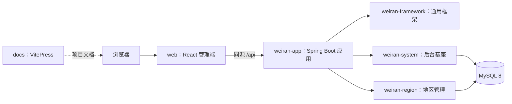

# 架构说明

## 总览

weiran4j 由 React 管理端、Spring Boot 后端和 MySQL 组成。开发时 Vite 将 `/api` 请求代理到后端；部署时 Nginx 提供静态页面并把 `/api` 同源转发给后端。



Turbo 管理根目录的前端、后端开发启动任务和 VitePress 文档构建。`pnpm dev` 会并行启动三项开发服务。

## 仓库目录

| 路径 | 职责 |
| --- | --- |
| `web/` | React 19、TypeScript、Semi UI 后台；动态菜单路由与权限按钮 |
| `weiran4j/weiran-framework/` | 统一响应、异常、认证拦截、权限注解和基础契约 |
| `weiran4j/weiran-system/` | 登录、用户、角色、菜单、部门、字典、系统配置和日志等通用能力 |
| `weiran4j/weiran-region/` | 行政区划管理与查询 |
| `weiran4j/weiran-app/` | 可执行 Spring Boot 应用、配置和集成测试 |
| `weiran4j/weiran-dependencies/` | Gradle 依赖版本平台 |
| `docs/` | VitePress 文档站，纳入 pnpm workspace 与 Turbo |
| `openspec/` | 需求、规格、工程规则和变更记录 |

## 后端模块分层

system 和 region 按五层组织，Gradle 项目名保持扁平，例如 `:weiran-system-api`，目录按模块嵌套：

```text
weiran4j/weiran-region/
├── weiran-region-api/
├── weiran-region-domain/
├── weiran-region-application/
├── weiran-region-infrastructure/
└── weiran-region-adapter/
```

| 层 | 主要职责 |
| --- | --- |
| `api` | 模块对外服务接口、命令和数据类型 |
| `domain` | 领域规则、实体和值对象、端口 |
| `application` | 编排用例，实现 API 服务 |
| `infrastructure` | 数据库访问、外部 SDK、配置和端口实现 |
| `adapter` | HTTP Controller、请求校验和权限声明 |

依赖由外向内：`adapter → application → domain`，`infrastructure → domain`。领域层不依赖 Spring、数据库或供应商 SDK。新业务模块应先登记模块和资源号段，再按五层创建目录；构建会自动发现完整模块。

## 请求与权限

1. 登录后端返回的菜单驱动前端路由和导航。
2. 浏览器使用 HttpOnly Cookie 携带令牌；写请求附带 CSRF Token。
3. 框架认证拦截器校验身份，`@RequiresPermission` 检查按钮权限。
4. Controller 调用 application 服务，服务通过 domain 端口访问基础设施。
5. 后端统一返回 `{code, message, data}`；成功 `code` 为数字 `0`。

数据库表由各模块的 Flyway 脚本创建。已经合入的迁移脚本不修改，只追加新脚本。

## 配置和权威文档

- 系统配置页面由分组和表单元数据驱动，具体用法见[系统配置说明](/configuration)。
- 本地配置放在 `weiran4j/config/application-local.yml`，不提交到版本库。
- 部署密钥通过环境变量注入，不写入源码或日志。
- API 与数据库契约见 `weiran4j/docs/01-架构与接口契约.md`；OpenAPI 由 Springdoc 动态生成，本地 Swagger UI 地址为 `/swagger-ui.html`，JSON 定义地址为 `/v3/api-docs`（仅 `local` profile 开启）；部署操作见 `weiran4j/docs/02-部署.md`；工程约束见根目录 `AGENTS.md`。
