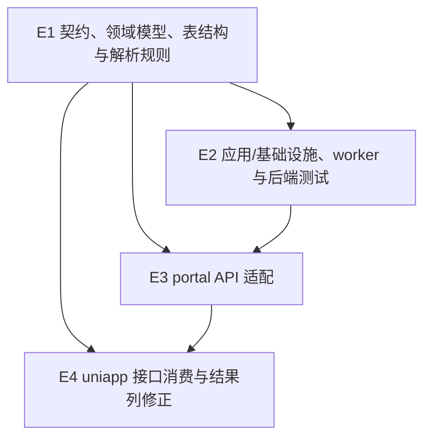

# Exec Plan

> L4 · 交接点：从意图到工程。此计划由 `tasks.md` 派生，不回写需求或设计。

## 1. 任务映射

| tasks.md 条目 | 执行单元 ID | 层 |
|---|---|---|
| `2.1` | `E1` | L0 |
| `2.2` | `E1` | L0 |
| `3.1` | `E2` | L1 |
| `3.2` | `E1`（迁移与数据契约）；`E2`（仓储与 worker） | L0 → L1 |
| `3.3` | `E2` | L1 |
| `3.4` | `E2` | L1 |
| `4.1` | `E3` | L1 |
| `5.1` | `E4` | L1 |
| `6.1` | `E1`（领域解析规则）；`E2`（应用/基础设施验证） | L0 → L1 |
| `6.2` | `E2`（portal 集成验证） | L1 |
| `6.3` | `E2` | L1 |
| `6.4` | `E2`（最终门禁，待 E3/E4 完成） | L1 收尾 |
| `6.5` | `E2`（真实学校账号上传到数据库的端到端集成验证） | L1 收尾 |

### 未映射条目

| 条目 | 不执行的原因 |
|---|---|
| 无 | tasks.md 所有条目均映射 |

### L7 测试基线

- 基线：当前 `main` 检出，`main...upstream/main [ahead 1]`；工作区包含已归档的站点配置 change 改动。本次只增量验证导入实现，最终证据在本 change 全部代码完成后统一生成。
- 全量命令以 `openspec/project.json` 为准；Java 构建使用 JDK 21，先 `spotlessApply` 再 `check`，不并发运行 Gradle 门禁。

## 2. 依赖图

| 执行单元 | 前置 | 依赖性质 |
|---|---|---|
| `E2` | `E1` | 类型依赖、数据依赖、调用依赖 |
| `E3` | `E1`,`E2` | DTO/服务签名与返回结构契约依赖 |
| `E4` | `E1`,`E3` | 页面消费 API 响应字段的契约依赖 |

## 3. 分层执行计划

### Layer 0 —— 契约与迁移，串行先做

| 执行单元 | 内容 | 涉及文件 |
|---|---|---|
| `E1` | 冻结导入领域/API 模型、任务与行表结构、模板字段规则和分组解析规则；追加唯一 CQT migration | `weiran-cqt-api/**/entry/**`、`weiran-cqt-domain/**/entry/**`、`weiran-cqt-domain/src/test/**`、`weiran-cqt-infrastructure/src/main/resources/db/migration/cqt/V*__cqt_school_import.sql` |

**完成判据**：领域规则单测通过；migration 的任务唯一键、任务/行索引和作品指纹策略确定；合同表所有字段已冻结。后续实现禁止自行改变字段语义。

### Layer 1 —— 依赖 Layer 0 的实现（本仓库按顺序交替，不并行写工作区）

| 执行单元 | 内容 |
|---|---|
| `E2` | 任务仓储、受限文件读取、Excel/ZIP 解析与安全边界、逐组事务写入、worker 恢复、查询用例和后端测试 |
| `E3` | CQT portal Controller 对接 uniapp 实际调用路径/参数/响应，并做学校身份和任务归属校验 |
| `E4` | uniapp 现有导入页面字段适配，修复学校/电话列映射，不消费奖项列；运行 uniapp build |
| `E2` 收尾 | E2/E3/E4 完成后统一跑集成验证、JDK 21 `spotlessApply` + `check` 与 OpenSpec 门禁证据 |

### 契约冻结

| 契约 | 签名 / 结构 | 定义位置 | 消费方(逐单元所读/写的字段) | 冻结 |
|---|---|---|---|---|
| 导入行 | `SchoolImportRow(sourceRow, entryType, declaredGroupSize, name, credentialType, credentialNo, phone, region, school, group, category, major, title, description, attachmentMode, attachmentValue, teachers, channel, validationError)`；不含省赛/国赛奖项 | `weiran-cqt-domain` 导入模型 | `E1` 写所有模板字段并忽略 U/V；`E2` 读作品、人员和附件字段；`E3` 不直接读行对象 | ☑ |
| 任务 | `SchoolImportTask(id, accountId, schoolId, competitionId, sessionId, status, totalRows, processedRows, successCount, failureCount, leaseUntil)` | CQT domain task port | `E2` 写状态/租约/计数；`E3` 经 application 读状态与计数；`E4` 仅通过接口读取序列化字段 | ☑ |
| 行结果 | `SchoolImportRowResult(taskId, sourceRow, lastSourceRow, groupKey, status, entryId, displayFields, errorMessage)` | CQT domain task port | 每个源数据行一条记录；同一作品组共享状态、作品 ID 与错误，逐行回显成员字段 | ☑ |
| 上传时效 | `uploadExpiresAt`；创建/更新后两小时失效 | CQT task 表与 domain task | `E2` 拒绝过期上传/确认，并在待处理检查前清理过期会话 | ☑ |
| 文件读取 | `StoredObjectReader.openOwnedObject(storedUrl, accountId)` | CQT domain file port | `E2` 读取仅本服务存储对象；infrastructure 校验 `FileStorage.isStoredUrl` 与存储归属，不做 HTTP 抓取 | ☑ |
| uniapp 上传确认 | 保持既有 `uploadAttachmentZiposs(oss_zip_url) -> session_id`、`uploadexceloss(session_id,oss_excel_url) -> excel_id`、`confirmImportoss(type,competitionid,session_id,excel_id,userid,zip_name,excel_name)`；服务端忽略 `userid` | CQT portal API | `E3` 写接口字段；`E4` 按原请求使用；状态/响应码符合 portal 契约 | ☑ |
| 任务查询 | `getTaskResult(competitionid)` 返回页面读取的任务列表；`getTaskDetail(Competitionid,id)` 返回汇总及 `results[]` | CQT portal API | `E3` 按学校过滤并返回字段；`E4` 读状态、计数、行号、学校、联系方式和错误，不读奖项列 | ☑ |

### 契约变更记录

| 时间 | 原签名 | 新签名 | 发起方 | 已通知 |
|---|---|---|---|---|
| 无 | — | — | — | — |

## 4. 并行判据与文件所有权

本仓库无 worktree；当前多个文件含此前已归档站点配置 change 的未提交改动，但不是并行中的他人改动。本 change 由一个执行上下文按 E1→E2→E3→E4→E5 顺序推进，禁止同时写同一工作区。

| ID | 场景 | 能否与他人并行 | 原因 |
|---|---|---|---|
| WT-0 | 工作区已有他人在推进的 change | ❌ 必须先确认 | 当前检查未见其他活跃 change；如出现他人新改动则暂停，避免证据和 L9 diff 混杂 |
| WT-1 | 文档/spec/OpenSpec 改动 | ✅ 可交替推进（仍受 WT-0 限制） | 零依赖 OpenSpec 检查 |
| WT-2 | 涉及 `weiran-framework` 或流水线本体 | ❌ 必须排队 | 本 change 不触及这两类共享层 |
| WT-3 | 单模块改动 | ✅ 可交替推进（仍受 WT-0 限制） | 业务实现只在 CQT 模块与 uniapp，但本 change 内仍串行交替 |

| 执行单元 | 拥有(可写) | 只读 | 禁止触碰 |
|---|---|---|---|
| `E1` | 本 change artifacts；CQT entry domain/api 与其测试；CQT school-import migration | 报名现有实现、uniapp | `weiran-framework/**`、站点配置文件、上游文件 |
| `E2` | CQT entry application/domain-specific adapter ports/infrastructure；CQT 后端测试 | `E1` 契约、portal controller、uniapp | `weiran-framework/**`、站点配置文件、未声明的上游文件 |
| `E3` | CQT portal adapter 与 API 契约文档 CQT 小节 | `E1/E2` 契约 | `weiran-framework/**`、站点配置实现、uniapp |
| `E4` | `uniapp/pages/my/my.vue` 与本次必要的 uniapp 类型/请求文件 | 冻结 API 契约 | CQT 后端、`web/**`、站点配置文件 |

### 测试归属

| 执行单元 | 测试范围 | 测试文件 |
|---|---|---|
| `E1` | 表头模型、分组规则与奖项列忽略 | CQT domain/application 单元测试 |
| `E2` | 解析、文件安全、任务恢复、作品写入与幂等 | CQT application/infrastructure 单测；`weiran-app` CQT portal 集成测试 |
| `E3` | 登录/学校类型/所有权及实际响应字段 | `weiran-app` CQT 集成测试 |
| `E4` | 页面字段显示与 H5 构建 | uniapp 现有测试/构建 |
| `E2` 收尾 | 全量门禁证据及上传到数据库的端到端集成验证 | `openspec/project.json` 指定命令、`CqtWebIT` |

### 失败与降级

| 场景 | 处置 |
|---|---|
| 外部执行单元或工具超时 | 重试一次；仍失败则由当前上下文串行完成 |
| 实现与批准设计冲突 | 暂停，更新上游 artifact 并重新走 L3，不在实现中静默缩小范围 |
| 后端契约需变更 | 暂停 E2/E3/E4，更新契约表并评估是否需要重新审批 |
| Gradle 检查失败 | 查 JDK 21 与 `toolchain.md`；同一检查修复后重跑仍失败则暂停并报告日志 |
| 工作区出现他人改动 | 暂停写入和 L7，等待工作区变更归属明确 |

## Gate

- [x] 每条 task 均映射，无未映射条目
- [x] `explore.md` 共享层清单已比对；无框架共享层改动，数据库 migration 放 Layer 0
- [x] 数据库仅新增 CQT migration；本 change 不兼容 PHP weiran-v1，无需核对旧系统迁移
- [x] 依赖图无环；adapter 与 uniapp 消费冻结契约
- [x] Layer 0 契约表列明并冻结消费字段
- [x] 测试跟随相应实现单元，没有独立测试执行单元
- [x] 执行单元按不同文件区域分工，不同时并行写工作区
- [x] 每个执行单元标记了禁止触碰区域
- [x] 失败与降级策略已填写
- [x] 本文件未回写 `tasks.md`、`design.md` 或 specs
