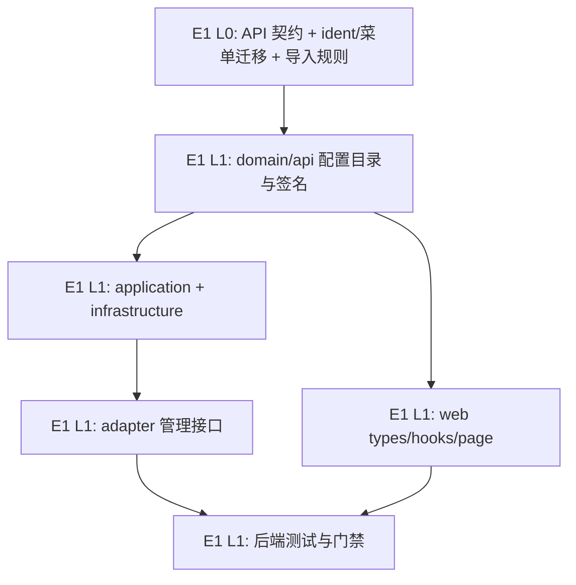

# Exec Plan

## 1. 任务映射

| tasks.md 条目 | 执行单元 ID | 层 |
|---|---|---|
| `1.1` 架构与接口契约文档 | `E1` | L0 |
| `2.1` ident 迁移与菜单种子 | `E1` | L0 |
| `2.2` 旧库导入脚本 | `E1` | L0 |
| `3.1` domain 目录、端口与映射 | `E1` | L1 |
| `4.1` application 管理用例 | `E1` | L1 |
| `4.2` infrastructure 管理仓储 | `E1` | L1 |
| `5.1` adapter 管理接口 | `E1` | L1 |
| `5.2` 后台图片上传 API | `E1` | L1 |
| `6.1` 前端类型与 API hooks | `E1` | L1 |
| `6.2` 独立配置表单 | `E1` | L1 |
| `6.3` 分类 Tab | `E1` | L1 |
| `6.4` Tiptap 富文本与图片上传 | `E1` | L1 |
| `6.5` 粘贴图片上传与插入 | `E1` | L1 |
| `7.1` 领域、仓储、迁移及公开接口验证 | `E1` | L1 |
| `7.2` 权限、审计和前端验证 | `E1` | L1 |
| `7.3` 富文本、图片上传与 Tab 验证 | `E1` | L1 |
| `7.4` 图片粘贴与普通文本粘贴验证 | `E1` | L1 |
| `7.5` 审查发现的非法保存载荷 400 校验 | `E1` | L1 |
| `8.1` 发布顺序说明 | `E1` | L1 |

### 未映射条目

| 条目 | 不执行的原因 |
|---|---|
| 无 | 所有任务均映射到 E1。 |

### L7 测试基线

- 基线：`main`（当前分支 `main`，HEAD 相对 `upstream/main` 仅已有 1 个与本 change 无关的前序提交；不改动、不回退该提交）。
- 验证范围：先跑 CQT domain/infrastructure/application 与 web 针对性验证；最终按仓库规范跑格式化及 `./gradlew check --no-daemon`、`pnpm lint`、`pnpm test`、`pnpm build`、`node openspec/check.mjs`。Gradle 使用 JDK 21；check 的集成测试需要 Docker。

## 2. 依赖图

执行单元为单一工作区串行推进；图中阶段用于表达依赖，不代表并行 agent。前后端共用以下冻结签名，先由契约与 domain 类型定稿，再实现两侧。

## 3. 分层执行计划

### Layer 0 —— 共享层与数据层，串行先做

| 执行单元 | 内容 | 涉及文件 |
|---|---|---|
| `E1` | 先更新唯一架构/接口契约；新增 CQT Flyway 迁移完成 ident 71 初始化与菜单权限种子；更新旧库导入脚本 | `weiran4j/docs/01-架构与接口契约.md`、`weiran-cqt-infrastructure/src/main/resources/db/migration/cqt/V202610151000__cqt_site_config_admin.sql`、`scripts/biz/import/cqt_setting.sql` |

**完成判据**：契约映射明确为 ident 2/71；新迁移仅插入缺失的 ident 71 行、菜单 id/按钮 id 全局唯一，并将原值复制为初始值；已有迁移不改。

### Layer 1 —— 串行实现与验证

| 执行单元 | 内容 |
|---|---|
| `E1` | 先完成 domain/api 管理模型和固定配置目录，再实现 application/infrastructure、adapter、前端分类 Tab、富文本、图片上传和剪贴板图片粘贴；随后补齐并运行测试、格式化及门禁。 |

#### 文件所有权

| 执行单元 | 拥有(可写) | 只读 | 禁止触碰 |
|---|---|---|---|
| `E1` | 本 change 涉及的 CQT 五层、CQT Flyway、`scripts/biz/import/cqt_setting.sql`、`weiran4j/docs/01-架构与接口契约.md`、`web/src/pages/cqt/**`、`web/src/hooks/queries/**`、`web/src/types/api.ts`、对应测试与 `openspec/changes/cqt-site-config-admin/**`、`openspec/state/bizs/cqt_setting.md` | 既有 system/framework 实现、`uniapp/**`、公开 API 调用方 | `weiran-framework/**`、`weiran-system/**`、`weiran-app/build.gradle.kts`、`web/src/App.tsx`、`web/src/layouts/AdminLayout.tsx`、其他业务模块 |

## 4. 契约冻结

| 契约 | 签名 / 结构 | 定义位置 | 消费方(逐单元列出所读/所写的键) | 冻结 |
|---|---|---|---|---|
| 管理配置项 | `SiteConfigItem(String key, String label, int ident, @Nullable String contents)` | `weiran-cqt-api/.../setting/SiteConfigItem.java` | `E1` domain/application 产出 `key,label,ident,contents`；adapter GET 返回；web 读取全部字段；PUT 只提交 `key,contents` | ☑ |
| 管理目录 | 固定 22 项；`guanyuwomen→2`、`user_agreement→71`，其余映射不变 | `SiteConfig` domain | `E1` domain 决定 ident；application 校验 key 集合；web 按 key 编辑 contents | ☑ |
| 管理读取 | `GET /api/cqt/site-config` → `{items: SiteConfigItem[]}` | `weiran4j/docs/01-架构与接口契约.md` | `E1` adapter 返回四字段；web 读取 `items[].key,label,ident,contents` | ☑ |
| 管理保存 | `PUT /api/cqt/site-config` body `{items: [{key, contents}]}`；成功返回现有统一响应 | `weiran4j/docs/01-架构与接口契约.md` | `E1` web 写入完整键集 `key,contents`；application 校验；adapter 要求 `cqt:site-config:update` | ☑ |
| 富文本图片上传 | `POST /api/cqt/site-config/images` multipart `file` → `{url,name,path,size}` | `weiran4j/docs/01-架构与接口契约.md` | `E1` 后端校验图片扩展名并复用 CQT 文件存储；前端上传成功后插入 URL | ☑ |
| 权限与审计 | GET `cqt:site-config:list`；PUT 与图片上传 `cqt:site-config:update`；配置保存有操作日志 | CQT controller 与菜单迁移 | `E1` adapter/controller 检查权限；web 菜单/按钮 gating；migration 注册对应权限 | ☑ |

### 契约变更记录

| 时间 | 原签名 | 新签名 | 发起方 | 已通知 |
|---|---|---|---|---|
| 2026-10-15 | `user_agreement→2` | `user_agreement→71`；新增 CQT 管理 GET/PUT | 需求澄清 | 是：本 change L3 已批准 |

## 5. 并行判据与文件所有权

| ID | 场景 | 能否与他人并行 | 原因 |
|---|---|---|---|
| WT-0 | 工作区已有其他 change | 否 | 单工作区共享状态，需保持仅本 change 活跃。 |
| WT-1 | 纯文档改动与代码改动 | 可交替，但本 change 内仍串行 | 没有 worktree；契约与代码由同一执行单元连续完成。 |
| WT-2 | framework 或流水线文件 | 否，且本 change 不涉及 | 本 change 不改公共框架或流水线。 |
| WT-3 | 单模块改动 | 可交替，但本 change 内仍串行 | 适用单模块 CQT；避免共用工作区并发编辑。 |

## 6. 测试归属

测试均由 `E1` 随实现编写和运行，不单独拆执行单元。

| 执行单元 | 测试范围 | 测试文件 |
|---|---|---|
| `E1` | 领域映射/原值保留；仓储更新与缺行插入；HTTP 鉴权、审计与公开响应；前端表单/请求；迁移与导入初始化 | `weiran-cqt-domain/src/test/**`、`weiran-cqt-infrastructure/src/test/**`、`weiran-app/src/test/java/com/weiran/app/CqtWebIT.java`、`web/src/pages/cqt/**` 对应测试 |

## 7. 失败与降级

| 场景 | 处置 |
|---|---|
| 构建受 JDK/daemon 影响 | 停止 daemon 或用 `--no-daemon`，并确认 JDK 21；不得绕过格式门禁。 |
| Docker 不可用导致集成测试无法启动 | 先完成 domain/模块检查与前端/OpenSpec 验证，记录集成测试受环境阻塞，不宣称全量通过。 |
| 发现 ident 71 已有业务数据或菜单 id 冲突 | 暂停迁移实现，重新核对数据与全局 id 后更新迁移设计；不覆盖不明数据。 |
| 契约实现中需改动 | 停止 adapter/web 实现，更新本节契约及 OpenSpec 设计，再恢复执行。 |

## 8. 收尾要求

单执行单元在 `exec/notes/E1-cqt-site-config-admin.md` 留下已完成任务、验证结果及必要连带改动；最终门禁通过后再写 `exec/verify.md`。

## Gate

- [x] 每条 task 都已映射，或已在「未映射条目」声明
- [x] explore 共享层清单已比对；Flyway 菜单数据迁移放在 Layer 0
- [x] 无表结构变化；新增 Flyway 数据迁移遵守 CP-7，仅新增脚本
- [x] 依赖图无环，前后端 API 契约依赖已识别
- [x] 契约冻结表已列出并锁定
- [x] 无独立测试执行单元
- [x] 只有一个执行单元，文件所有权无交集
- [x] 禁止触碰目录已写明
- [x] 失败与降级策略已填
- [x] 本文件未回写 tasks/design/specs
