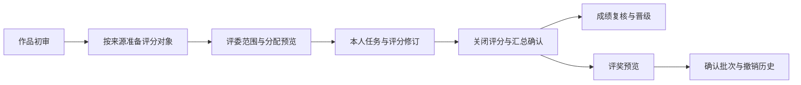

# Design

## Context

需求与确认规则见interview.md，现状与影响面见explore.md，能力范围见proposal.md。用户已确认：独立综合分、维度记录、算术平均HALF_UP两位、闭区间无名额且同分同奖；中戏作品级ENTRY，渠道/后台参赛人级PARTICIPANT。

用户已于2026-10-17明确回复“实现”，并在暂停后回复“继续”，L3已批准，可以生成tasks与实施代码。CLI模板中wuli3、PHP、无Flyway、字符串0等旧叙述均不适用，以下采用本仓真实Java21/MySQL/Semi及数字0契约。

## 宪法对照

| 原则 | 判定 | 说明 |
| --- | --- | --- |
| CP-1 领域层不依赖框架 | ☑ | 规则、状态、平均计算与端口仅Java及纯契约类型，Spring/MyBatis留外层 |
| CP-2 依赖方向单向向内 | ☑ | adapter→application→domain，infrastructure实现domain端口 |
| CP-3 持久化类型不跨层 | ☑ | DO/Mapper/Wrapper限infrastructure，端口返回领域快照或API DTO |
| CP-4 版本号只有一个来源 | ☐ | 不新增依赖或版本，复用现有库与BigDecimal |
| CP-5 质量规则只在build-logic | ☐ | 不更改质量配置 |
| CP-6 豁免最小且带理由 | ☑ | 不新增全局豁免，反射DO沿用NullUnmarked边界映射 |
| CP-7 追加Flyway | ☑ | 仅新增V202610170400迁移；不改已执行脚本、不直接DDL |
| CP-8 BCrypt/token_version | ☐ | 复用后台用户登录，不处理密码或令牌吊销 |
| CP-9 凭据不入库日志 | ☑ | 无新密钥，评分/身份敏感内容不写应用日志或console |
| CP-10 认证错误一致 | ☐ | 不改登录或认证失败语义 |
| CP-11 错误码决定状态 | ☑ | 复用BizException与CommonErrors，控制器不手写状态或转换异常 |
| CP-12 业务→基座→框架 | ☑ | review/award留在weiran-cqt，不新增横向业务依赖 |
| CP-13 仅system-api接触基座 | ☑ | UserService.get/options查询评委，禁止JOIN sys_user，菜单种子沿现有扩展入口 |
| CP-14 错误码号段 | ☑ | 优先通用40000/40300/40400/40900，不新领号码 |
| CP-15 菜单权限表前缀 | ☑ | cqt:权限、菜单1050–1126、db/migration/cqt、cqt_表，均在已领号段 |

## Architecture

所有HTTP入口为后台/api/cqt；API与应用服务分review/award子域，复用现有entry/competition的领域事实。系统API只查询有效后台用户。数据库事务覆盖状态、版本、快照和派生失效写入，不在事务中远程请求或调用存储服务。

## Data Flow

### 来源与对象

1. 新普通/团体/学校导入作品source_database取当前账号来源；zhongxi派生scoring_scope=ENTRY，qudao/houtai派生PARTICIPANT。中戏每作品一个目标，其余每有效参赛人一个目标；报名和导入仍在原作品组事务内完成。
2. 历史作品以已存source_database为权威，不由成员、学校或渠道名称反推。准备预览按来源核对scoring_scope与目标集合；只有无任务、评分、汇总和奖项引用时可修正，保留旧目标为非ACTIVE并幂等建立正确集合。有引用的冲突明确阻断，不自动迁移评分。
3. 历史正确目标及ID保持；多次准备不得新增重复目标。同作品不允许ENTRY和PARTICIPANT同时作为有效评分集合。团体人员级对象分别显示参赛人，所有写入以targetId而非entryId定位。

### 初审与阶段

- INITIAL为管理员对作品的定性初审，不分配多人评委、不录数字分；通过/驳回、原因、操作者、版本和历史留档。驳回须原因；通过可附意见。
- 每赛事有INITIAL/PROVINCIAL/NATIONAL唯一阶段。省国审配置总分上下限、最低评委数、可空晋级线；数字至多两位，最低人数≥1。阶段状态DRAFT→OPEN→CLOSED→FROZEN；首次OPEN前规则与目标准备完整。
- 初审通过的有效作品对应目标进入省审候选，NATIONAL-only作品不进入省审。阶段关闭立即拒绝评分草稿和提交；FROZEN表示已确认汇总。
- 管理员在未产生下游评分前可带原因重审；已有省国审评分时不可直接撤回初审，需先显式失效相应阶段/下游结果，保留历史。

### 规则与范围

- 评分规则/维度保存不可变revision；维度按阶段+一级赛项管理名称、说明、记录分区间、排序。OPEN后不得原地改规则；需关闭并重开新revision。新的revision不会沿用旧草稿或把旧提交冒充新评分，页面显示待重新评分。
- 评委范围包含userId、competitionId、phaseCode、省/国阶段、一级赛项、可选专业/赛区、enabled。专业/赛区为空为不限；所有外键与父子关系及赛事一致性由服务端核验。
- 管理员业务权限默认覆盖全部赛事，不新造全局赛事/来源ACL；评委只见本人有效assignment，且每次读取/写入核验用户启用、scope匹配、作品/参赛人/目标有效及当前阶段。即使知道他人ID也不可读写。
- 停用范围使匹配任务不可提交，已有提交只保留历史并使相关有效汇总/奖项STALE；范围不能被简单删除来掩盖影响。操作先预览影响并带原因确认。基座用户禁用没有CQT事件回调，本切片不增加事件/worker：每次业务读取、预览和确认通过UserService重新取用户状态及updatedAt，发现禁用或快照变化后惰性使相关结果STALE并拒绝旧预览。与基座禁用并发的请求以本次校验快照为准，下一业务读取重新核验，不承诺跨模块瞬时推送失效。

### 分配与评分

- 手工分配和自动分配都先预览，返回target、reviewer、已有任务、越界/缺人原因、工作量与previewToken。自动分配在合法scope候选中按当前有效任务数、userId稳定排序，补齐每对象指定人数，不重复分配已有有效评委。
- 确认时重验作品、阶段、规则、scope、用户状态和候选版本。存在未覆盖对象须调整范围或显式从候选中移除后重新预览，不默认静默跳过。单次候选≤500目标，总新任务≤5000，超限要求缩小筛选，事务不承接无限全表任务。
- 同阶段同对象同评委唯一；CANCELLED任务可恢复且沿用assignmentId，恢复重验范围。取消已提交任务必须额外管理权限、原因及影响预览，旧评分留档，不再计入有效评分，关联结果STALE。
- 评分状态EMPTY/DRAFT/SUBMITTED；草稿可不完整，提交要求所有启用维度的记录分和评语、独立综合分齐全且在范围内，维度不计算权重、不相加替代综合分。评语trim后非空且≤2000字，分数字段最多两位。
- 请求带expectedVersion，评分写入CAS；当前用户决定reviewerId，不接受客户端替换。开放且未冻结时可修订，旧记录保留revision；相同内容的幂等重试不追加重复修订。未提交草稿不得进入平均分。

### 汇总、复核与晋级

- 管理员关闭阶段后预览汇总。以有效且提交、对应当前规则revision的不同评委综合分计算普通平均，HALF_UP两位。至少达到minimumReviewers才有成绩；无需所有分配评委均提交，预览明确列出待评、缺评和未达最低人数。
- 确认携带输入版本hash，事务锁阶段行，再重验当前评分/assignment/scope/目标/规则版本；所有会改变输入的操作也锁同一阶段行并递增inputVersion。任一漂移409要求重新预览，不基于陈旧快照确认。
- 汇总为本阶段全部当前候选生成确认快照；可确认达标子集，未达最低人数或失效对象仅生成缺评/失效快照并将旧成绩标STALE，不产生有效新final。预览须明确完整达标与跳过清单，管理员显式接受缺评后才能确认并令阶段FROZEN；没有任何达标对象时拒绝确认。用户要补评时需重开再评分汇总。有效最终分与计算快照记录原评分revision和规则revision。
- 成绩管理员仅在FROZEN阶段可带理由更正有效最终分，不修改评委原始分；更正记录前后值与操作者，生成新finalVersion，使相关已确认奖项批次STALE并保留原奖项历史。需重新预览评奖才能形成新有效奖项。
- 重开阶段必须原因与影响预览；使该阶段及依赖它的晋级/下游已生成结果失效待复核，不删除历史。FROZEN阶段不接受直接评分；重开后显式处理旧final/award状态。
- 晋级状态ELIGIBLE/ADVANCED/ELIMINATED/LOCKED，独立于计算状态，重算不得把人工决定悄悄重置。阈值仅产生建议名单，管理员确认后才晋级；人工决定必须原因。前置最终成绩失效时晋级标待复核，不继续推进。
- SHARED赛事确认晋级后将同一target纳入国审；SEPARATE只生成资格，绝不复制作品或绕过独立报名。已有合法NATIONAL/BOTH作品可由管理员关联资格（同赛事、同来源、一级赛项、证件规范化集合匹配，ENTRY需完整成员集合，PARTICIPANT需对应参赛人），记录关联与理由后进入国审。尚无国赛作品显示待独立报名。本切片不新增前台国赛报名入口。

### 评奖

- 规则适用赛事、阶段、ENTRY/PARTICIPANT、一级赛项，可选专业/组别，包含奖项名、闭区间[min,max]、排序、enabled与revision。只评评分对象奖，不派生教师/学校奖。区间在综合分范围内，不允许同一可重叠适用域的启用规则交叠；端点相同也算交叠，通配与具体范围重叠同样拒绝，不能靠优先级掩盖冲突。
- 只读取有效确认finalVersion；预览返回命中、未命中、冲突、失效成绩及对应规则。多人同分均获同奖，不设名额、排名或比例截断。预览token绑定赛事、阶段、规则/最终成绩版本和完整候选快照，30分钟过期。
- 确认时阶段锁、重验hash与当前版本；冲突或失效输入拒绝。一个事务生成CONFIRMED批次、批次专属awards/award_grants及规则/分数快照，不复用其它批次的可变award行。
- 对同一阶段/候选已有有效奖项的再次确认须明确替代原批次，不允许两个批次同时成为同对象同阶段有效结果；替代原子标旧批次STALE并建立supersedesBatchId关系。子集替代若与原批次候选不一致则拒绝，须按原批次完整候选重做，避免误停未选中对象的奖项。
- 确认幂等键存储payloadHash与结果；相同键同体返回原batchId，不同体409。撤销带原因/expectedVersion，仅改变所属批次及其专属授奖有效状态；旧批次再撤销不能影响替代批次。原始快照不可覆盖。
- 不生成证书、不公开成绩；后续查询只能消费有效确认结果，STALE/REVOKED不得作为可发布数据。

## 跨模块契约变更(DS-1)

framework和system-api签名不改；CQT review/award API、目标来源定义、状态及web类型属于共享输入，L4先冻结。实施前将以下接口、表和菜单同步到docs/01，再写代码；本设计不替代唯一契约。报名外部请求/响应不变，仅修正来源和评分对象的内部落库规则，修改既有cqt-entry-signup FR-005。

## API Design(DS-2)

以下均属weiran-cqt-adapter；列表PageQuery/PageResult，统一{code:0,message,data}；命令成功返回{id,version}或明确统计。所有写接口RequiresPermission且OperationLog，GET不记写日志。路径参数中的赛事、阶段、对象必须服务端复核，ID与权限不能替代归属校验。

| 路由（前缀/api/cqt） | 方法 | 请求关键字段 | 返回关键字段 | 权限 |
| --- | --- | --- | --- | --- |
| /review/options | GET | 无 | 按权限限定的赛事/赛项/专业/赛区选项；用户池仅管理权限可见 | 各业务list权限ANY |
| /review/entries | GET | competitionId,keyword,source,status,page | 作品/初审状态/来源/scoringScope/缺对象原因 | cqt:entry-review:list |
| /review/entries/{id} | GET | id | 附件/成员姓名及评分对象/初审历史，无证件全文 | cqt:entry-review:list |
| /review/entries/{id}/decision | POST | decision,reason,expectedVersion | 初审版本/影响 | cqt:entry-review:decide |
| /review/targets/prepare-preview | POST | competitionId,entryIds | 修正候选/阻断/previewToken | cqt:entry-review:prepare |
| /review/targets/prepare | POST | previewToken,requestKey | created/unchanged/blocked | cqt:entry-review:prepare |
| /review/phases | GET/POST | competitionId / 创建赛事阶段 | 阶段及revision列表 / id | cqt:review:list / update |
| /review/phases/{id} | PUT | min/max/minReviewers/晋级线,expectedVersion | 新规则revision | cqt:review:update |
| /review/phases/{id}/dimensions | GET/PUT | 一级赛项/维度集合,expectedVersion | 维度revision | cqt:review:list / dimension |
| /review/phases/{id}/state-preview | POST | OPEN/CLOSED/REOPEN,reason | 影响及previewToken | cqt:review:open |
| /review/phases/{id}/state | POST | previewToken,requestKey | 阶段新版本 | cqt:review:open |
| /review/reviewers | GET/POST | 筛选 / scope字段 | 范围分页 / id | cqt:reviewer:list / create |
| /review/reviewers/{id} | PUT | scope/enable,reason,expectedVersion,影响token | 新版本 | cqt:reviewer:update |
| /review/assignments | GET | 赛事/阶段/评委/状态/keyword | 任务分页及工作量 | cqt:assignment:list |
| /review/assignment-candidates | GET | competitionId,phaseId,source,targetType,categoryId,keyword,page,pageSize | targetId,entryId,participantId及姓名(可空),来源,对象类型,eligible,blockedReason,assignedCount,version | cqt:assignment:create或auto |
| /review/assignments/preview | POST | mode,targetIds,userIds,每对象人数 | 覆盖/缺人/负载/previewToken | cqt:assignment:create或auto |
| /review/assignments/confirm | POST | previewToken,requestKey | 新增/重复/确认结果 | 同预览对应权限 |
| /review/assignments/{id}/state | POST | cancel/restore,reason,expectedVersion,影响token | 新状态及版本 | cqt:assignment:cancel / restore |
| /review/my-tasks | GET | 赛事/阶段/状态/keyword | 本人任务分页 | cqt:review-task:list |
| /review/my-tasks/{id} | GET | assignmentId | 作品/对象/维度/本人当前分及历史/可操作原因 | cqt:review-task:list |
| /review/my-tasks/{id}/score | PUT | DRAFT/SUBMITTED,total,dimensions,comment,expectedVersion,requestKey | scoreVersion | cqt:review-task:score |
| /review/scores | GET | competitionId,phaseId,状态/keyword | 有效/缺评/STALE成绩分页 | cqt:score:list |
| /review/phases/{id}/calculate-preview | POST | 当前全部候选 | 平均分/不足明细/previewToken | cqt:score:calculate |
| /review/phases/{id}/calculate | POST | previewToken,acknowledgeSkipped,requestKey | 汇总版本及统计 | cqt:score:calculate |
| /review/scores/{id}/correct | POST | finalScore,reason,expectedVersion | finalVersion/影响批次 | cqt:score:correct |
| /review/scores/{id}/history | GET | id | 计算/更正/重开快照 | cqt:score:history |
| /review/phases/{id}/advance-preview | POST | threshold或人工targetIds,decision,reason | 晋级建议/阻断/previewToken | cqt:score:advance |
| /review/phases/{id}/advance | POST | previewToken,requestKey | 决定版本 | cqt:score:advance |
| /review/phases/{id}/promote | POST | targetIds,expectedVersion,requestKey | 国审候选或独立报名资格 | cqt:score:promote |
| /review/qualifications/{id}/attach | POST | nationalTargetId,reason,expectedVersion,previewToken,requestKey | 关联资格版本 | cqt:score:promote |
| /award/rules | GET/POST | 规则筛选 / 区间及适用域 | 分页 / id | cqt:award-rule:list / create |
| /award/rules/{id} | PUT | 规则/enable,expectedVersion | 新revision | cqt:award-rule:update |
| /award/preview | POST | competitionId,phaseId,候选过滤/原替代批次 | 命中/未匹配/冲突/previewToken | cqt:award-batch:preview |
| /award/batches | GET/POST | 筛选 / previewToken,requestKey,supersedesBatchId | 分页 / batchId | cqt:award-batch:list / confirm |
| /award/batches/{id} | GET | id | 快照、逐对象奖项和历史 | cqt:award-batch:detail |
| /award/batches/{id}/revoke | POST | reason,expectedVersion,requestKey | 本批次撤销状态 | cqt:award-batch:revoke |

预览公共返回{previewToken,expiresAt,inputVersion,summary,rows,blockedRows}；确认不接受客户端自算奖项/分数。预览token仅是不透明UUID，不承载姓名证件或可信权限；服务端保存用途、操作者、payloadHash、候选版本和结果快照。scope/assignment的影响token由相应状态预览接口提供；影响操作无有效token不得提交。汇总缺评清单不是输入版本冲突：确认体需acknowledgeSkipped=true；缺人分配、重复命中奖项和输入漂移仍是整次确认的阻断。

补齐辅助接口如下，均沿用同一模块及响应约定：

| 路由（前缀/api/cqt） | 方法 | 请求/返回 | 权限 |
| --- | --- | --- | --- |
| /review/reviewers/{id}/state-preview | POST | 拟更新scope/enabled,expectedVersion→任务/结果影响token | cqt:reviewer:update |
| /review/assignments/{id}/state-preview | POST | cancel/restore,expectedVersion→影响token | cqt:assignment:cancel或restore |
| /review/qualifications | GET | competitionId,状态,page→资格、原target/finalVersion、已关联国赛target | cqt:score:list |
| /review/qualifications/{id}/candidates | GET | 合法现有NATIONAL/BOTH目标分页、匹配/不匹配原因，无证件号 | cqt:score:promote |
| /review/qualifications/{id}/attach-preview | POST | nationalTargetId,reason,expectedVersion→成员匹配与影响token | cqt:score:promote |

/review/options改为RequiresPermission ANY各业务列表权限（entry-review、review、reviewer、assignment、review-task、score、award-rule、award-batch），不要求额外review:list。对仅有review-task权限的调用，只返回本人任务关联的赛事/阶段/赛项选项，不给用户池；用户候选仅供具有reviewer维护或assignment管理权限者，且只含id/username/nickname，无手机号/邮箱/登录信息。资格attach确认必须携带attach-previewToken并验证来源、当前有效资格与国赛目标唯一关联；独立报名创建仍不在本切片。

跨阶段失效按phaseId升序锁相关阶段，避免省审重开和国审确认死锁；输入漂移失败时回滚完整命令，不留下部分授奖或成功receipt。

## Database Design(DS-3)

仅追加 `weiran-cqt-infrastructure/src/main/resources/db/migration/cqt/V202610170400__cqt_review_scoring_awards.sql`，实现前查重。以下所有表均为cqt_前缀、BIGINT主键、created/updated审计；命令聚合有version。JSON仅用于不可变输入/输出快照，不代替可查询关系。评分使用DECIMAL(8,2)并领域校验。

| 表（省略cqt_） | 关键数据 | 唯一键/索引 |
| --- | --- | --- |
| entry_review_decisions | entry_id,decision,reason,operator_id,version,历史链 | entry_id+version，当前版本索引 |
| review_phases | competition_id,code,state,current_rule_id,input_version,version | competition_id+code |
| review_phase_rules | phase_id,revision,min/max,minimum_reviewers,晋级线 | phase_id+revision |
| review_dimensions | rule_id,first_category_id,name,min/max,sort | rule_id+赛项+维度身份 |
| reviewer_scopes | user_id,competition_id,phase_id,赛项/专业/赛区,enabled,version | 精确scope规范化唯一，user/phase索引 |
| review_assignments | phase_id,target_id,reviewer_id,state,version | phase+target+reviewer；reviewer/state索引 |
| review_scores | assignment_id,current_revision,status,rule_id,version | assignment_id |
| review_score_revisions | score_id,revision,total,comment,operator_id,状态 | score_id+revision |
| review_dimension_scores | score_revision_id,dimension_id,value,comment | revision+dimension |
| phase_target_status | phase_id,target_id,decision,status_version,reason,input_final_version | phase+target |
| final_scores | phase_id,target_id,final_score,average,count,state,version,snapshot_id | phase+target，state索引 |
| score_snapshots | phase_id,target_id,input_version,规则/评分revision列表,输出 | phase+target+版本 |
| score_corrections | final_score_id,before/after,reason,operator_id,final_version | final_score_id+version |
| review_qualifications | source_phase/target,final_version,national_target_id,status,version,关联原因 | source_phase+target+final_version；national_target唯一有效关联 |
| award_rules | phase_id,target_type,赛项/可选专业组别,名称,区间,enabled,revision | phase+适用域索引；范围冲突领域/事务锁校验 |
| award_batches | phase_id,status,input_version,preview_id,supersedes_batch_id,reason,version | phase/status；preview_id唯一确认 |
| awards | batch_id,target_id,rule_revision,score_version,奖项/分数快照,status | batch+target；有效结果由批次及当前final联合校验 |
| award_grants | batch_id,award_id,target_id,recipient_type | award_id唯一，batch索引；只ENTRY/PARTICIPANT |
| review_previews | purpose,operator_id,phase_id,payload_hash,input_version,snapshot,expires_at | token主键，expiry索引；30分钟失效，按操作惰性清理 |
| review_command_receipts | operator_id,operation,request_key,payload_hash,result_ref | operator+operation+request_key唯一 |

沿用entries/evaluation_targets结构；新增来源与人员目标写入方法，不改变旧表主键和外部ID。score/correction/decision/assignment历史不可物理删除。命令receipt与业务写入同事务，事务失败不留下成功回执。外键一致性由仓储事务+必要约束共同保证，不用可空归属绕过校验。

## 权限与已知缺口(DS-4)

sys_menu目录1055“赛事评审”；1050作品初审、1060评审配置、1070评委管理、1080评委分配、1090我的评审、1100成绩与晋级、1110奖项规则、1120评奖批次。1051–1054、1061–1064、1071–1074、1081–1085、1091–1093、1101–1106、1111–1114、1121–1125为各页按钮，具体按钮语义按API同码配对。1086分配详情、1094评分详情、1126评奖预览为隐藏菜单。祖先菜单查询权限在按钮授权时配套；新增操作码不能只有按钮没有可访问页面。种子只给超级管理员绑定，不给现有普通用户自动扩大权限。

增加独立权限cqt:entry-review:{list,decide,prepare}、cqt:review:{list,update,dimension,open}、cqt:reviewer:{list,create,update}、cqt:assignment:{list,create,auto,cancel,restore}、cqt:review-task:{list,score}、cqt:score:{list,calculate,correct,history,advance,promote}、cqt:award-rule:{list,create,update}、cqt:award-batch:{list,preview,confirm,detail,revoke}。按钮与菜单ID分配时同码避免重复授权歧义；保留号可不插入，不能插入无操作的占位权限。

隐藏菜单不引入框架不支持的OR权限字符串：1086使用cqt:assignment:list挂载，1094使用cqt:review-task:list，1126使用cqt:award-batch:list；进入页面不代表可执行动作。手工/自动按钮分别检查create/auto，候选与预览接口使用RequiresPermission ANY两者；确认复核token所绑定mode的对应权限。配置角色时动作须配套对应list及父目录，评奖confirm还须配套preview以生成本人token。这样仅有auto而配套list的角色仍可进入分配页，不依赖create。只读list用户进入隐藏页也不能生成预览、提交评分或确认奖项。

scope列表必须返回完整scope字段及version，奖项规则列表返回完整适用域、上下界、enabled及revision/version，成绩列表返回targetId/entryId/participantId/phaseId、平均/最终分、有效人数、状态、finalVersion。编辑、纠错不从展示文本或客户端缓存猜ID/版本；候选列表始终按评分对象分页，不能以作品列表代替PARTICIPANT对象。

读权限不泄露完整证件；附件只提供已有地址，不代替用户提交外部下载或上传。文件类型与URL遵循现有存储约定。已知本仓无通用数据范围、导出任务中心、工作流引擎；本切片仅实现业务必需的scope、锁及幂等，不宣称补齐全局能力。

## 分层与装配(DS-5)

domain管理ReviewPhase、ReviewAssignment、ScoreRevision、FinalResult、AwardRule、AwardBatch及端口；application在事务中编排预览确认、CAS、失效和UserService校验；infrastructure持久化与锁；adapter取CurrentUser并检查权限。三层CQT AutoConfiguration自注册；应用不加ComponentScan/MapperScan。端口签名不得含Spring/MyBatis。现有模块内扩展，不改Gradle依赖聚合。

## 前端设计(DS-6)

| 页面component | 路由 | 核心交互 |
| --- | --- | --- |
| cqt/review/EntryReviewsPage | /cqt/review/entries | 作品初审、附件/成员、对象准备预览、阻断原因 |
| cqt/review/ReviewPhasesPage | /cqt/review/phases | 阶段/规则/维度、关闭与重开影响确认 |
| cqt/review/ReviewersPage | /cqt/review/reviewers | 现有用户选择、范围配置、停用影响 |
| cqt/review/AssignmentsPage | /cqt/review/assignments | 范围与工作量、取消恢复影响 |
| cqt/review/AssignmentCreatePage | /cqt/review/assignments/create | 手工/自动选择与预览后确认 |
| cqt/review/MyReviewTasksPage | /cqt/review/my-tasks | 本人待评/已评任务，按target区分成员 |
| cqt/review/ReviewTaskPage | /cqt/review/my-tasks/:assignmentId | 独立Tab、附件、维度记录及综合分、草稿/提交/历史 |
| cqt/review/ScoresPage | /cqt/review/scores | 缺评、汇总、快照、更正、晋级和独立报名资格关联 |
| cqt/review/AwardRulesPage | /cqt/review/award-rules | 适用范围与闭区间重叠检查 |
| cqt/review/AwardBatchesPage | /cqt/review/award-batches | 有效/过期/撤销批次及详情 |
| cqt/review/AwardPreviewPage | /cqt/review/award-batches/preview | 命中/未命中/冲突明细、过期刷新和确认 |

复用PageContainer/SearchToolbar图标查询重置、列设置、刷新、TableActions、Permission、usePageTabs、Semi Form/Modal/SideSheet/Upload已有能力。表格列宽按实际最坏值设置；默认无高级搜索。筛选草稿/已生效值分开，切赛事清阶段/专业/旧结果，TanStack Query键含赛事阶段/对象/分页。表单用expectedVersion，409保留输入并提示重载复核；评分草稿保存留页，提交成功关闭当前Tab并刷新本人列表。mutation令下游列表/预览缓存失效；不记录响应PII到console。菜单驱动路由，不改App.tsx或AdminLayout硬注册。

## Observability

- 写接口OperationLog记录操作、内部ID、状态和耗时；业务表保存原因、修订、前后版本，应用日志只记录安全ID和错误类别。
- 完整身份证、手机号、令牌、评分评语不进入日志。现有OperationLog会序列化方法参数且没有关闭参数开关，本切片不改框架：adapter请求DTO的comment/reason及嵌套维度评语使用Jackson WRITE_ONLY字段（能接收输入、不参与日志序列化），不得使用原始Map或未脱敏字符串参数接收这些内容；输出/历史DTO与输入分离。业务表保存完整必要原因与评语，操作日志仅安全ID、动作与版本摘要，不记录响应体；异常消息不得拼接评语。
- 页面显示缺评数、未覆盖对象、STALE依赖和版本冲突，作为管理员排障入口；不新增指标服务或worker。

## Test Plan

当前仅设计，未新增或运行测试，未宣称测试通过。下述为验收场景；测试执行遵循用户后续明确授权。

| 范围 | 可观测场景 |
| --- | --- |
| 规则与对象 | 来源分流、团体人员目标不双计、准备幂等、已引用目标阻断转换 |
| 范围/评分 | 跨评委读写403、阶段关闭409、分数越界400、草稿不算分、CAS冲突、维度记录不改变总分 |
| 汇总 | 80/90平均85.00、两位HALF_UP、最低人数不足旧成绩STALE、范围取消/用户禁用后不可继续确认旧预览 |
| 并发 | 关闭评分与提交竞争、重开与评奖确认竞争、同幂等键相同/不同payload、过期token409 |
| 晋级 | 重算保留人工决定但失效版本禁止推进；SHARED进国审、SEPARATE仅资格且不重复作品 |
| 评奖 | 闭区间相接与通配重叠拒绝、同分同奖、STALE输入拒绝、撤旧不影响替代、重试不重复批次 |
| 页面 | 菜单配对、搜索/重置/列设置/刷新、独立评分Tab保存关闭、冲突/空态/权限原因可见 |

编译/静态检查使用JDK21、先spotlessApply；前端tsc/lint/build与openspec结构校验可按当前授权执行。完整check包含测试，未授权时不得冒充完成全量门禁。

## Rollout Plan

1. L3审批后在唯一接口契约同步API/表/状态/菜单，L4冻结后按数据→后端→页面顺序实现；不在规划期间创建业务表。
2. 新增表默认无开放阶段、无任务、无奖项；只给超管菜单，评委账号和范围由管理员显式配置。
3. 在明确的隔离验证数据上逐段验收：初审/配置、分配评分、汇总晋级、评奖。不开前台查询、不导入真实历史数据、不自动给真实作品评分/颁奖。
4. 更新新表逐表现状文档及README.biz索引；既有问题只在实际完成时关闭，不先标已解决。

## Rollback Plan

- 回退锚点：本change首个实施提交前的工作区变更清单及git基线67b2de5；前序内容/学校导入未提交改动为本会话既有成果，必须保留，禁止直接git reset/stash覆盖整个工作区。部署有提交后以该change独立提交为revert锚点。
- 停止入口：先关闭省国评分，撤下新菜单授权；保留全部评分、快照及批次数据用于审计。不自动撤销已确认业务决定。
- 应用可回退到不使用新增表的旧版本，新增表不drop、不修Flyway history；需要数据修正时追加修复迁移。来源与对象新增写法须随应用版本整体回退，已产生人员级评分的作品不自动转换回ENTRY。

## Open Questions

- 无未决核心规则；上述初审方式、冻结/重开、独立报名资格、规则适用域及失效机制作为具体方案提交L3审阅，用户可在批准前调整。

## 2026-10-17 用户追加：测试与作品导出

请求来源为用户本轮明确指令，不改原评分/评奖规则。导出详细契约已先行登记于docs/01的“作品清单导出（2026-10-17追加）”，作为唯一字段协议。独立entryexport子包提供domain投影端口、application阶段锁与POI工作簿、JDBC查询及adapter直接下载；不修改既有ReviewRepository协议。POST带CSRF，独立export权限及筛选审计。

每次导出必须明确competitionId/phaseId。ENTRY每作品一行，PARTICIPANT每有效成员一行，未准备对象和来源冲突保留问题行，不能自动创建对象或平均合并多人分数。导出23列、空奖项、模板版本说明；ID为文本，用户内容非公式；单次10000行，超限400，无PII。全局响应包络只对成功工作簿跳过，失败保持统一错误。新增权限迁移不改旧脚本。Semi弹层及工具区导出按钮使用已生效筛选，锁定在途请求，下载失败不生成文件。

本轮测试授权取代此前exec plan的无测试限制；测试仅使用隔离测试库/Testcontainers，不写本地真实作品评分或奖项。先跑现有全量测试，再纳入新增源码运行最终build/test/lint；独立交叉复核后记录真实结论。
