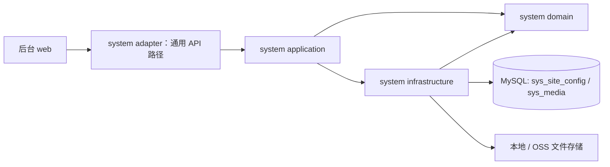

# Design

## Context

- 需求来源：`interview.md`。本次只做站点配置富文本与图片管理；不迁入新闻；HTTP API 统一使用 `/api/system/**`。
- 命名约定：相关管理接口统一使用 `/api/system/**`，权限码统一使用 `system:` 前缀；后端实现位于 `weiran-system`，菜单 id 与 Flyway 模块段按 system 号段管理，媒体表使用 `sys_` 前缀。实现时须先检索全仓路由和权限码，确认无冲突。
- 现有实现调研：`explore.md`。复用 Tiptap 编辑交互；system 当前没有文件存储、媒体索引或站点配置服务，本次新增这些能力。
- 关键约束：新增 Flyway 迁移；站点配置字段使用通用命名；本地与 OSS 存储语义一致；不登记或推断旧对象。

## 宪法对照

| 原则 | 判定 | 说明 |
|---|---|---|
| CP-1 领域层不依赖框架 | ☑ | 媒体资产领域类型保持纯 Java，不引用 Spring/MyBatis 类型。 |
| CP-2 依赖方向单向向内 | ☑ | 适配层调用应用服务，应用层调用 domain 端口，基础设施实现端口。 |
| CP-3 持久化类型不跨层 | ☑ | `*DO`、Mapper 与 MyBatis 查询只留在 system infrastructure。 |
| CP-4 版本号只有一个来源 | ☑ | OSS SDK 版本统一由框架 BOM 管理，模块不声明版本号。 |
| CP-5 质量规则只在 build-logic 里配置 | ☐ | 不改质量规则或 Gradle 约定。 |
| CP-6 豁免必须最小且带理由 | ☐ | 设计不需要质量规则豁免。 |
| CP-7 表结构只经 Flyway 迁移变更，已发布的迁移永不修改 | ☑ | 站点配置表、媒体表和菜单只通过新增 `V202610170001__system_media_library.sql` 创建。 |
| CP-8 密码只用 BCrypt，令牌吊销只走 token_version | ☐ | 不涉及密码或令牌生命周期。 |
| CP-9 凭据不进版本库、不进日志 | ☑ | OSS 凭据经环境变量配置；日志记录资产 id/结果，不记录密钥或图片二进制。 |
| CP-10 认证失败不泄露账号存在性 | ☐ | 不改登录或认证失败路径。 |
| CP-11 错误码归属决定 HTTP 状态，不靠 Controller 判断 | ☑ | Controller 不捕获异常或手写状态；引用冲突由业务异常统一处理。 |
| CP-12 依赖只能业务 → 基座 → 框架，反向与同层横向禁止 | ☑ | 所有新增后端逻辑均在现有 `weiran-system` 模块内，不新增跨业务依赖。 |
| CP-13 业务只经基座的 `weiran-system-api` 接触基座 | ☑ | 本次能力属于 system 模块内部；通过现有认证、权限与日志机制，不新增业务模块对基座的横向依赖。 |
| CP-14 错误码按号段分配，业务不得占用框架与基座的号段 | ☑ | 沿用 `BizException` 通用错误，不新增错误码。 |
| CP-15 权限码、菜单 id 与 Flyway 模块段按层隔离 | ☑ | 本次权限码使用 `system:` 前缀；菜单 id 使用 system 号段，迁移放 `db/migration/system/`，站点配置表与媒体表均使用 `sys_` 前缀。 |

## Architecture

## Data Flow

1. 站点配置编辑器和图片库都通过 `POST /api/system/media/images` 上传单张图片；图片库允许一次选择多张，并逐张发起请求，分别显示成功或失败状态。
2. 后端校验 jpg/jpeg/png/gif 与单张 10 MB 上限，写入现有 system 文件存储并登记媒体元数据；编辑器上传成功后按顺序把 URL 插入光标位置。
3. 图片库分页查询只读取 `sys_media`，按创建时间倒序；关键词只匹配原始文件名。历史上已存在、但没有资产记录的对象不展示。
4. 图片删除与站点配置保存都在事务开始后，按 ident 升序锁定 `sys_site_config` 配置行（`SELECT ... FOR UPDATE`），再检查引用或写入内容。删除在持锁期间检查引用；数据库事务提交后才删除对象和资产记录，避免事务回滚留下指向已删除对象的记录。若外部存储删除成功但资产行删除失败，重复删除请求可安全重试。复用配置数据行作互斥点，不新增专用锁表。

## 跨模块契约变更(DS-1)

| 对象 | 文件 | 动作 | 消费方 |
|---|---|---|---|
| 框架错误码 | `weiran-framework/.../error/CommonErrors.java` | 不修改 | 继续复用通用错误语义 |
| 框架分页 | `weiran-framework/.../page/{PageQuery,PageResult}.java` | 不修改 | 媒体 adapter 与 web 页面 |

## API Design(DS-2)

| 路由 | 方法 | 所属模块 | 请求关键字段 | 返回关键字段 | 权限点 |
|---|---|---|---|---|---|
| `/api/system/site-config` | GET | system adapter（system API 路径） | — | 通用站点配置项及原始内容 | `system:site-config:list` |
| `/api/system/site-config` | PUT | system adapter（system API 路径） | 配置项全量列表 | 成功包络 | `system:site-config:update`；`@OperationLog` |
| `/api/system/media/images` | POST | system adapter（system API 路径） | multipart `file` | `url`, `name`, `path`, `size` `system:media-library:upload`；`@OperationLog` |
| `/api/system/media-library` | GET | system adapter（system API 路径） | `page`, `pageSize`, `keyword` | 分页图片资产 | `system:media-library:list` |
| `/api/system/media-library/{id}` | DELETE | system adapter（system API 路径） | 路径 `id` | 成功包络或引用冲突 | `system:media-library:delete`；`@OperationLog` |

- 本次 web 调用的 HTTP 路径统一使用 `/api/system/` 前缀，权限码统一使用 `system:` 命名空间。上传编辑器也需要 `system:media-library:upload` 权限。
- 管理 API 使用框架统一响应 `{code, message, data}`；Controller 不手写状态码或捕获业务异常。
- 图片库多选上传以每张一个请求执行，单文件失败可独立重试。

## Database Design(DS-3)

| 表 | 动作 | 关键字段 | 索引 | 备注 |
|---|---|---|---|---|
| `sys_site_config` | 新增 | `id`, `ident`, `contents`, `created_at`, `updated_at` | `(ident,id)` | 站点配置内容；富文本原样保存 |
| `sys_media` | 新增 | `id`, `original_name`, `url`, `object_name`, `size`, `uploaded_by`, `created_at` | `UNIQUE(object_name)`、`UNIQUE(url)`、`(created_at,id)`、`(original_name)` | 系统媒体资产索引，仅登记新上传的后台图片 |
| `sys_menu` / `sys_role_menu` | 新增种子 | 菜单 12、13；按钮 121–125 | 主键 | 使用 system 菜单号段；角色 id 1；幂等插入 |

- 新迁移：`weiran4j/weiran-system/weiran-system-infrastructure/src/main/resources/db/migration/system/V202610170001__system_media_library.sql`。现有菜单最大 id 为 120；菜单 id 12、13 与按钮 id 121–125 空闲。
- 迁移为通用站点配置写入空值初始项，不读取任何业务数据库或业务表。历史图片对象不回填、不创建伪造媒体记录。

## 权限与已知缺口(DS-4)

| 项 | 设计 |
|---|---|
| 权限点(`sys_menu.permission`) | `system:media-library:list/upload/delete`；站点配置使用 `system:site-config:list/update`。 |
| 菜单挂载 | 后端菜单驱动；图片库页面路由 `/system/media-library`，component 为 `system/media-library`。HTTP API 统一使用 `/api/system/**`。 |
| 操作日志 | 图片上传/删除及站点配置保存标 `@OperationLog`；日志不含二进制内容。 |
| 已知缺口 | 历史上传对象不在图片库中；用户需重新上传后才能管理。上传后未引用的图片不会自动清理。 |

## 分层与装配(DS-5)

| 项 | 设计 |
|---|---|
| 依赖方向 | `adapter → application → domain`；`infrastructure → domain`。 |
| 领域契约 | 媒体资产模型和端口在 domain；视图与应用服务接口在 system API 层。 |
| 持久化 | MyBatis `DO`、Mapper 与 SQL 仅在 infrastructure；应用与 domain 不暴露 ORM 类型。 |
| 自动配置 | 媒体与站点配置应用服务、Mapper 与仓储加入 system 自动配置；应用配置增加存储环境变量占位。 |
| 文件存储 | system 新增 `FileStorage` 端口；本地实现校验目标路径位于 root 内，OSS 实现校验对象名并删除登记对象。 |
| 引用保护 | 配置保存和图片删除事务都按相同顺序按 ident 升序锁定全部站点配置行，再检查/修改内容；配置行作为互斥点，不新增锁表。 |

## 前端设计(DS-6)

| 项 | 内容 |
|---|---|
| 页面/路由 | 新增 `web/src/pages/system/media-library.tsx`；站点配置仍为 `web/src/pages/system/site-config.tsx`。 |
| 菜单挂载 | 迁移写入 `component='system/media-library'`，与页面文件逐字配对。 |
| 数据请求方式 | 页面查询逻辑放在 `web/src/hooks/queries/system-media.ts`；API 类型同步登记在 `web/src/types/api.ts`。 |
| 复用组件 | 复用 `SiteConfigRichEditor`、`PageContainer`、`SearchToolbar`、`Permission` 与 `utils/request.ts`。 |
| 权限控制点 | 媒体列表、上传、删除分别按 media-library 权限控制；站点配置写权限沿用现有权限。 |
| 多图交互 | 图片库多选文件后逐张上传，独立显示成功/失败；缩略图支持预览，操作含复制 URL 与删除。 |

## Observability

- 日志关键字段：媒体资产 id、对象名、操作者 id、上传大小、删除结果；不记录凭据或文件内容。
- 指标：沿用现有请求与操作日志，不增加指标系统。
- 审计：后台写接口使用 `@OperationLog`；不增加公开写接口。
- 告警 / 排障入口：存储异常按现有 system 上传失败日志和应用错误日志排查。

## Test Plan

| 层级 | 范围 | 命令 |
|---|---|---|
| domain/application | 媒体资产校验、引用保护、配置行锁协调 | `./gradlew :weiran-system-domain:test :weiran-system-application:test` |
| infrastructure/adapter | 本地/OSS 删除、Mapper、权限/日志、媒体接口 | `./gradlew :weiran-system-infrastructure:test :weiran-system-adapter:test` |
| 集成 | MySQL 迁移、配置 API、媒体上传/引用保护 | `./gradlew :weiran-app:test` |
| 前端 | 编辑器多图插入、媒体上传/搜索/复制/删除 | `pnpm --filter @weiran/web test` |
| 全量门禁 | 后端与规格 | `./gradlew check --no-daemon`、`pnpm lint`、`pnpm build`、`node openspec/check.mjs` |

## Rollout Plan

1. 追加 system Flyway 迁移，创建媒体表及菜单/权限种子。
2. 发布 `/api/system/**` 站点配置和媒体 API 与前端页面；之后的新图片上传进入媒体索引。
3. 现有存储 URL 继续有效；历史对象不自动回填。

## Rollback Plan

1. 回滚锚点：本 change 对应提交或发布 tag；回退应用版本即可停用新页面/API。
2. 新 Flyway 脚本只新增表和菜单，不写破坏性 down migration；回滚时保留表和资产记录，避免已保存内容引用失效。
3. 站点配置 API 使用通用路径；若回滚应用版本，需同时回滚前端，避免新旧路径不匹配。数据库表保留以供修复版本读取。

## Open Questions

- 无
