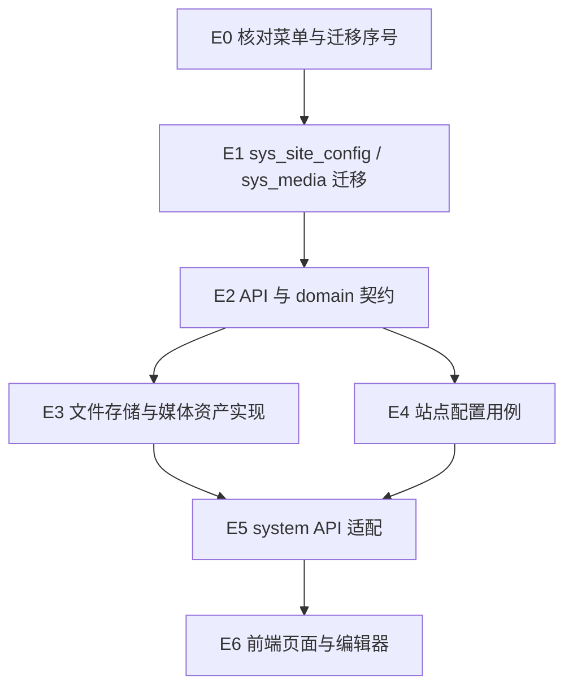

# Exec Plan

## 1. 任务映射

| tasks.md 条目 | 执行单元 ID | 层 |
|---|---|---|
| `0.1` | `E0` | 准备 |
| `1.1` | `E1` | L0 数据迁移与菜单契约 |
| `2.1` | `E2` | L1 API/domain 契约 |
| `3.1` | `E3` | L2 文件存储与媒体实现 |
| `3.2` | `E4` | L2 站点配置用例 |
| `4.1` | `E5` | L3 HTTP 适配 |
| `5.1` | `E6` | L4 前端 |

测试覆盖段落是实现单元的验收范围，不是独立任务。

### 未映射条目

无。

### L7 测试基线

- 基线：`main`。
- 后端：JDK 21 下运行 `./gradlew spotlessApply`，再运行 `./gradlew check --no-daemon`。
- 前端：`pnpm test`、`pnpm lint`、`pnpm build`。
- 规格：`node openspec/check.mjs`。

## 2. 依赖图

| 执行单元 | 前置 | 依赖性质 |
|---|---|---|
| E1 | E0 | 菜单和迁移序号需先确认 |
| E2 | E1 | 契约字段与数据结构匹配 |
| E3 | E2 | 依赖 domain 端口与 API 类型 |
| E4 | E2 | 依赖配置契约与存储端口 |
| E5 | E3、E4 | Controller 调用已冻结应用服务 |
| E6 | E5 | 页面按已实现 HTTP 契约接入 |

## 3. 执行层

- L0：E0、E1 顺序执行，确认序号并创建数据库迁移、菜单与权限种子。
- L1：E2 冻结请求/响应、媒体模型与存储端口。
- L2：E3 与 E4 属不同模块文件，但当前共享工作区不并行写入；先 E3 后 E4。
- L3：E5 接入认证权限与操作日志。
- L4：E6 实现页面与编辑器交互。
- L5：各实现单元完成后依项目门禁统一格式化和验证。

## 4. 契约冻结表

| 契约 | 定义位置 | 消费方 | 冻结 |
|---|---|---|---|
| 媒体上传响应：`url`, `name`, `path`, `size` | system API upload view | E3、E5、E6 | ☑ |
| 媒体列表：分页 `list`, `total`, `page`, `pageSize` | system API media view | E3、E5、E6 | ☑ |
| 站点配置：ident 与原始 `contents` | system API site-config DTO | E4、E5、E6 | ☑ |
| HTTP 路由与权限：`/api/system/**`、`system:*` | design.md §API Design | E5、E6 | ☑ |
| 数据表：`sys_site_config`、`sys_media` | system Flyway migration | E1、E3、E4 | ☑ |

### 契约变更记录

| 时间 | 原签名 | 新签名 | 发起方 | 已通知 |
|---|---|---|---|---|
| — | — | — | — | — |

## 5. 并行判据与文件所有权

本仓库使用同一工作区，不开并行执行单元；严格按 E0 → E6 顺序推进。

| 执行单元 | 拥有（可写） | 只读 | 禁止触碰 |
|---|---|---|---|
| E1 | system infrastructure Flyway、菜单种子 | design.md、tasks.md | 已合入迁移、框架契约 |
| E2 | system API/domain 类型与端口 | E1 schema | 持久化实体与 Controller |
| E3 | system application/infrastructure 媒体与存储 | E2 契约 | adapter、web |
| E4 | system application/infrastructure 站点配置 | E2 契约 | adapter、web |
| E5 | system adapter | E2–E4 契约 | web |
| E6 | `web/src/pages/system/**`、对应组件与本地查询 | API 契约 | system Java 源码 |

## 6. 测试归属

测试跟随 E3–E6 实现；集成测试统一在最终门禁执行。

| 执行单元 | 覆盖范围 |
|---|---|
| E3 | 存储路径校验、上传/删除、资产查询与引用保护 |
| E4 | 原始富文本保存、ident 初始化、配置行锁 |
| E5 | system 权限、统一响应与操作日志 |
| E6 | 多图选择/粘贴、上传状态、搜索/预览/复制/删除 |

## 7. 失败与降级

| 场景 | 处置 |
|---|---|
| 构建或迁移失败 | 停止后续单元，修复当前单元后重跑 |
| API 契约需要变更 | 暂停 E3–E6，先更新契约并同步消费者 |
| 同一工作区出现并行改动 | 停止本轮修改，确认所有者后再继续 |

## 8. 收尾要求

- 每个执行单元完成后记录实际改动与验证结果。
- 仅在完整实现且对应行为成立后勾选 tasks.md。

## Gate

- [x] 每条 task 都已映射
- [x] 共享层和数据库迁移先行
- [x] 依赖图无环，前后端契约依赖已识别
- [x] 契约冻结表已列出
- [x] 无独立测试执行单元
- [x] 当前采用顺序执行，无重叠文件所有权
- [x] 每个执行单元的禁止触碰范围已写明
- [x] 失败与降级策略已填
- [x] 测试范围归属实现单元
- [x] 本文件未回写 tasks.md、design.md 或 specs
