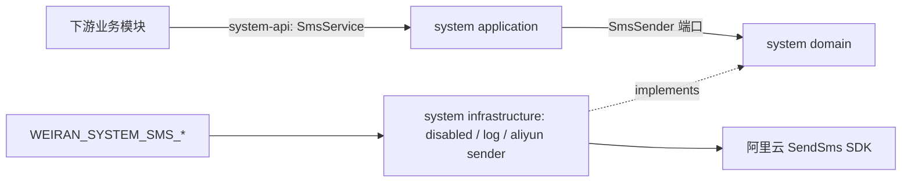

# Design

> 描述行为与边界；逐文件执行顺序留给 `exec/plan.md`。

## Context

- 需求来源：`interview.md`、`proposal.md`。
- 现状调研：`explore.md`。参考实现使用阿里云 `dysmsapi20170525` SDK；本项目 system 尚无短信服务。
- 关键约束：SMS 发送由 system API 提供给业务模块；system 不生成验证码、不提供 HTTP 接口；发送结果不幂等，必须单次尝试。

## 宪法对照

| 原则 | 判定 | 说明 |
|---|---|---|
| CP-1 领域层不依赖框架 | ☑ | `SmsSender` 与结果类型使用纯 Java；SDK、Spring 配置留在 infrastructure/application。 |
| CP-2 依赖方向单向向内 | ☑ | application 依赖 system-api 与 domain；infrastructure 只实现 domain 端口，不依赖 application。 |
| CP-3 持久化类型不跨层 | ☐ | 本 change 不引入持久化类型或 MyBatis-Plus。 |
| CP-4 版本号只有一个来源 | ☑ | 阿里云短信 SDK 版本集中约束在 `weiran-dependencies`；模块声明不写版本。 |
| CP-5 质量规则只在 build-logic 里配置 | ☐ | 不改质量规则或约定插件。 |
| CP-6 豁免必须最小且带理由 | ☐ | 预计不需要新增任何规则豁免。 |
| CP-7 表结构只经 Flyway 迁移变更，已发布的迁移永不修改 | ☐ | 不新增或修改数据库结构。 |
| CP-8 密码只用 BCrypt，令牌吊销只走 token_version | ☐ | 不处理密码、令牌或认证状态。 |
| CP-9 凭据不进版本库、不进日志 | ☑ | AccessKey 只从环境变量绑定；启动错误只列缺失变量名，SDK 异常不输出原始消息。 |
| CP-10 认证失败不泄露账号存在性 | ☐ | 不涉及账号认证。 |
| CP-11 错误码归属决定 HTTP 状态，不靠 Controller 判断 | ☐ | 不增加 Controller 或 HTTP 错误响应。 |
| CP-12 依赖只能业务 → 基座 → 框架，反向与同层横向禁止 | ☑ | system 增加通用基座能力，只依赖 framework 和第三方 SDK，不依赖业务模块。 |
| CP-13 业务只经基座的 `weiran-system-api` 接触基座 | ☑ | 短信发送服务及命令/结果类型放入 system-api，供下游调用。 |
| CP-14 错误码按号段分配，业务不得占用框架与基座的号段 | ☐ | 不增加业务或通用错误码。 |
| CP-15 权限码、菜单 id 与 Flyway 模块段按层隔离 | ☐ | 不增加权限、菜单或 Flyway 脚本。 |

## Architecture

## Data Flow

1. 业务模块构造 `SmsSendCommand`，提供目标手机号、短信模板 CODE 和模板参数，并调用 `SmsService.send`。
2. system application 调用当前配置的 sender：`disabled` 返回 `NOT_CONFIGURED`，`log` 记录模板消息并返回 `LOGGED`，`aliyun` 调用阿里云。
3. infrastructure 将模板参数序列化为阿里云要求的 JSON，使用配置的签名、端点和凭据调用一次 `SendSms`。
4. 阿里云结果映射为 `SENT`、`RATE_LIMITED`、`INVALID_NUMBER` 或 `FAILED`；发送异常映射为 `FAILED`。
5. `aliyun` 日志仅记录手机号掩码、结果类别和安全的请求号；`log` 模式显式记录模板代码与参数以供受控开发/测试联调。任何模式都不记录 AccessKey 或原始 SDK 异常消息。

## 跨模块契约变更(DS-1)

| 对象 | 文件 | 动作 | 消费方 |
|---|---|---|---|
| system 短信服务 | `weiran-system-api/.../api/sms/` | 新增 `SmsService`、`SmsSendCommand` 与 `SmsSendResult` | 下游业务模块 application |
| 短信发送端口 | `weiran-system-domain/.../domain/sms/` | 新增 `SmsSender` 与内部 `SmsSendOutcome` | system application / infrastructure |

`SmsSendCommand` 只含 `phone`、`templateCode`、`Map<String, String> templateParameters`；签名名称为 system 部署配置，短信 endpoint 固定使用阿里云公网默认值 `dysmsapi.aliyuncs.com`。接口不是 HTTP API，不使用 Spring 类型、SDK 类型或数据库类型。

## API Design(DS-2)

| 路由/方法 | 所属模块 | 请求关键字段 | 返回关键字段 | 权限点 |
|---|---|---|---|---|
| Java `SmsService.send(SmsSendCommand)` | `weiran-system-api` | 手机号、模板 CODE、模板参数 | `SmsSendResult`：`SENT` / `LOGGED` / `NOT_CONFIGURED` / `RATE_LIMITED` / `INVALID_NUMBER` / `FAILED` | 无 HTTP 权限点；仅由应用内业务服务调用 |

- 不新增 REST 路由、统一响应或前端契约。
- 调用方负责手机号/模板有效性、验证码生命周期、用户级与 IP 级频率限制，以及业务级重复发送决策。
- 短信发送不自动重试，调用方收到 `FAILED` 后不得假定厂商未受理；重试策略属于业务决策。

## Database Design(DS-3)

| 表 | 动作 | 关键字段 | 索引 | 备注 |
|---|---|---|---|---|
| — | 不涉及 | — | — | 不存储短信、验证码或发送历史。 |

没有新 Flyway 脚本或菜单行。

## 权限与已知缺口(DS-4)

| 项 | 设计 |
|---|---|
| 权限点 | 无 HTTP Controller，不注册 `system:*` 菜单权限。 |
| 菜单挂载 | 无管理页面，不增加菜单。 |
| `@OperationLog` | 不涉及用户触发的写接口；由业务模块决定是否记录其业务动作。 |
| 调用授权 | Java 服务不在网络上公开；调用边界由依赖注入和应用模块访问控制。 |
| 已知缺口 | 不提供发送频率限流、验证码存储/校验、发送审计表或供应商余额监控。 |

## 分层与装配(DS-5)

| 项 | 设计 |
|---|---|
| API | `weiran-system-api` 定义纯 Java 命令、结果枚举和服务接口。 |
| domain | `weiran-system-domain` 定义发送端口和与厂商无关的结果分类。 |
| application | system application 实现 API 服务，调用 domain 端口；未配置 provider 时返回 `NOT_CONFIGURED`。 |
| infrastructure | system infrastructure 属性绑定短信配置，按 `disabled` / `log` / `aliyun` 装配 sender；`aliyun` 缺少必需配置时启动失败。 |
| 自动配置 | 在现有 `SystemApplicationAutoConfiguration` / `SystemInfrastructureAutoConfiguration` 登记服务和配置；沿用已有 `.imports` 自动发现。 |
| SDK 依赖 | `dysmsapi20170525` 版本 `4.6.0` 集中约束在 dependencies BOM，infrastructure 用无版本声明。 |

## 前端设计(DS-6)

| 项 | 内容 |
|---|---|
| 页面/路由 | 不新增。 |
| 菜单挂载 | 不新增。 |
| 数据请求方式 | 下游业务通过 system API 的 Java 服务调用。 |
| 复用组件 | 无。 |
| 权限控制点 | 不提供 HTTP 入口；下游业务如有用户操作需自行授权。 |

## Configuration

- `weiran.system.sms.mode` / `WEIRAN_SYSTEM_SMS_MODE`：`disabled` 默认，可设为 `log` 或 `aliyun`。`log` 记录短信模板代码与参数并返回 `LOGGED`，不调用外部服务；因模板参数可能包含验证码或个人信息，仅用于受控的开发/测试环境，并需限制日志访问及保留时间。
- `WEIRAN_SYSTEM_SMS_ACCESS_KEY_ID`、`WEIRAN_SYSTEM_SMS_ACCESS_KEY_SECRET`、`WEIRAN_SYSTEM_SMS_SIGN_NAME`：`aliyun` 模式必填。
- 阿里云 endpoint 固定为 `dysmsapi.aliyuncs.com`；`WEIRAN_SYSTEM_SMS_CONNECT_TIMEOUT` 与 `WEIRAN_SYSTEM_SMS_READ_TIMEOUT` 单位为秒，默认 3 和 5；`aliyun` 模式下必须为正整数，否则启动失败且错误只列配置项名称。
- AccessKey 只通过部署环境变量设置，不写仓库 `.env.example` 的真实值；`.env.example` 只列空占位。`log` 不需要阿里云凭据。
- `aliyun` 模式缺少凭据/签名时启动失败；未配置 provider（`disabled`）返回 `NOT_CONFIGURED`；SDK 发送抛异常时返回 `FAILED`，不透出原始异常消息。

## Observability

- 日志关键字段：`aliyun` 记录结果类别、手机号掩码、阿里云请求号；`log` 额外记录模板代码与参数，手机号仍掩码。
- 指标：本 change 不增加指标。
- 审计：没有 HTTP 写接口，不新增 `@OperationLog`。
- 告警 / 排障入口：调用方根据结果类别处置；部署人员检查阿里云控制台签名、模板、RAM 权限和余额。
- SDK 异常日志只输出异常类名，不输出 `getMessage()` 或凭据。`aliyun` 不输出模板参数；`log` 模式是为开发/测试联调显式开放的内容日志模式。

## Test Plan

| 层级 | 范围 | 判据 |
|---|---|---|
| API/domain | 纯 Java 命令和结果类型、发送结果分类 | 无 Spring 与阿里云 SDK 类型泄漏；结果分类边界稳定。 |
| application | 无 provider / 有 provider、请求传递 | 无 provider 返回 `NOT_CONFIGURED`；有 provider 时只调用一次并映射结果。 |
| infrastructure | 配置完整性、三种模式装配、SendSms 请求映射、结果分类、异常脱敏、重试设置 | 假网关与日志捕获断言模式行为；SDK 尝试次数为 1；缺配置异常不含密钥。 |
| build | system 模块编译与静态质量规则 | JDK 21 下 Gradle 编译成功，无版本漂移和质量规则违规。 |

## Rollout Plan

1. 部署前在阿里云短信控制台审核短信签名与业务模板，创建最小权限的 RAM 子账号。
2. 先保持默认 `disabled` 部署代码；本地联调可显式设置 `WEIRAN_SYSTEM_SMS_MODE=log`；确认 AccessKey、签名与模板后，在下游服务环境设置 `WEIRAN_SYSTEM_SMS_MODE=aliyun` 及必需变量并重启。
3. 由业务模块通过 system API 发送其已审核的模板；不在 system 提供通用公网测试接口。

## Rollback Plan

1. 紧急停止发送：将 `WEIRAN_SYSTEM_SMS_MODE` 设为 `disabled` 并重启；业务调用收到 `NOT_CONFIGURED`。
2. 代码回滚锚点：本 change 实现提交的 revert commit；若尚未提交，回滚仅限本 change 所属文件，不覆盖用户已有工作区修改。
3. 无数据库迁移和数据回滚步骤。

## Open Questions

- 无
