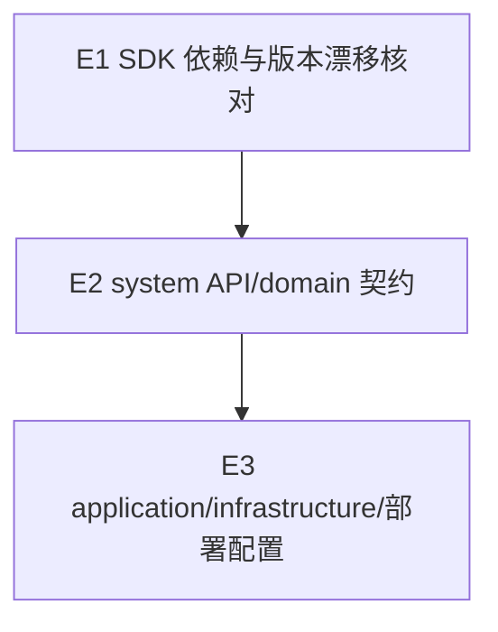

# Exec Plan

> L4 · 交接点：任务到工程实现。本文件从 tasks 派生，不回写需求、设计或规格。

## 1. 任务映射

| tasks.md 条目 | 执行单元 ID | 层 |
|---|---|---|
| `0.1` | `E1` | L0 |
| `1.1` | `E1` | L0 |
| `2.1` | `E2` | L1 |
| `2.2` | `E2` | L1 |
| `2.3` | `E2` | L1 |
| `3.1` | `E3` | L2 |
| `3.2` | `E3` | L2 |
| `3.3` | `E3` | L2 |
| `3.4` | `E3` | L2 |
| `3.5` | `E3` | L2 |
| `3.6` | `E3` | L2 |
| `5.1` | `E3` | L2 |
| `5.2` | `E3` | L2 |

### 未映射条目

无。

### L7 测试基线

- 基线：当前 `main` 工作区；该分支含用户授权并行推进的 region 提交 `65d7d33`。短信 change 只验本次改动，不覆盖 region 的未提交内容。
- 计划门禁：JDK 21 下 `spotlessApply` 和 system application/infrastructure 单元测试，再执行 OpenSpec 校验。

## 2. 依赖图

| 执行单元 | 前置 | 依赖性质 |
|---|---|---|
| `E2` | `E1` | 需要确认 SDK 的集中版本约束和传递依赖兼容性 |
| `E3` | `E2` | application 需实现冻结的 system API，infrastructure 需实现 domain 端口 |

## 3. 分层执行计划

### Layer 0 —— 共享层，串行

| 执行单元 | 内容 | 涉及文件 |
|---|---|---|
| `E1` | 核查阿里云 SDK 传递依赖；在 dependencies BOM 集中加入版本约束 | `weiran4j/weiran-dependencies/build.gradle.kts`、必要时 `weiran4j/docs/01-架构与接口契约.md` 的版本兼容说明 |

完成判据：依赖版本单一来源，若出现与框架版本漂移则按 CP-6 登记最小理由豁免或调整 SDK 版本。

### Layer 1 —— 契约

| 执行单元 | 内容 |
|---|---|
| `E2` | 新增 system-api Java 服务契约、domain 发送端口，并更新唯一架构与接口契约文档 |

### Layer 2 —— 应用与基础设施

| 执行单元 | 内容 |
|---|---|
| `E3` | 实现 application 服务与自动配置、disabled/log/aliyun sender、配置校验和装配；同步 application.yml、.env.example、部署文档，固定阿里云 endpoint |

## 4. 契约冻结

| 契约 | 签名 / 结构 | 定义位置 | 消费方 | 冻结 |
|---|---|---|---|---|
| 短信服务 | `SmsSendResult send(SmsSendCommand command)` | `weiran-system-api/.../api/sms/SmsService.java` | `E3` 读取 phone、templateCode、templateParameters 并映射发送状态 | ☑ |
| 发送命令 | `phone: String`、`templateCode: String`、`templateParameters: Map<String,String>` | `weiran-system-api/.../api/sms/SmsSendCommand.java` | `E3` 读取三个字段构建厂商请求；不含凭据与签名 | ☑ |
| 发送结果 | `SENT / LOGGED / NOT_CONFIGURED / RATE_LIMITED / INVALID_NUMBER / FAILED` | `weiran-system-api/.../api/sms/SmsSendResult.java` | `E3` 对领域结果分类并返回 | ☑ |
| 领域端口 | `SmsSendOutcome send(String phone, String templateCode, Map<String,String> templateParameters)` | `weiran-system-domain/.../domain/sms/SmsSender.java` | `E3` 读取 API 命令字段并传给端口；domain 不依赖 system-api | ☑ |

### 契约变更记录

新增 `LOGGED` 结果，供显式启用的 log 模式区分已记录与真实发送成功。

## 5. 并行判据与文件所有权

本 change 内串行推进；同一工作区同时有 region 工作，用户明确授权本 change 与其并行。执行单元不交叉编辑文件。

| 执行单元 | 拥有（可写） | 只读 | 禁止触碰 |
|---|---|---|---|
| `E1` | dependencies BOM、依赖核对文档（如需） | 源项目 SDK 实现 | `web/.env.development`、`WeiranApplication.java`、region change 文件 |
| `E2` | system-api、system-domain、架构契约文档 | BOM 与 design/spec | `web/**`、region change 文件、用户已有未提交文件 |
| `E3` | system-application、system-infrastructure、其 src/test、application.yml、.env.example、部署文档 | API/domain 契约 | `web/**`、region change 文件、用户已有未提交文件 |

## 6. 测试归属

测试不另拆执行单元；`E3` 覆盖 application 请求/结果映射，以及 infrastructure 的 SDK 请求映射、配置校验、返回码、脱敏、重试和 disabled/log 行为。

## 7. 失败与降级

| 场景 | 处置 |
|---|---|
| SDK 传递依赖造成框架版本漂移 | 停止依赖集成，按 CP-6 评估最小兼容策略后再继续 |
| 编译或 OpenSpec 校验失败 | 修复本 change 范围内问题并重跑一次；若仍失败则报告具体阻塞 |
| 契约需要变更 | 暂停 E3，先修订上游设计与契约并重新评审 |
| 发现与 region 修改冲突 | 保留双方改动，停止涉及冲突文件的操作并报告 |

## 8. 收尾要求

实现完成后记录 E1-E3 的实际改动和验证结果，供 L6/L8 对照。

## Gate

- [x] 每条 task 均已映射
- [x] explore 共享层命中项落在 Layer 0
- [x] 无数据库结构变更
- [x] 依赖图无环
- [x] 契约冻结表完整
- [x] 无独立测试执行单元
- [x] 执行单元文件所有权不相交
- [x] 禁止触碰文件已写明
- [x] 失败与降级策略已填写
- [x] 未回写 tasks/design/specs
