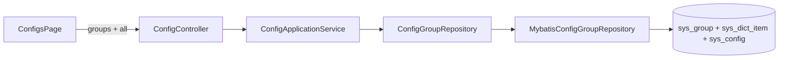

# Design

## Context

- 需求来源：`interview.md`
- 现有实现调研：`explore.md`
- 关键约束：新增 Flyway 迁移；领域层不访问数据库；字典页面与 API 保持兼容，但字典主表并入 `sys_group`。

## 宪法对照

| 原则                                                  | 判定 | 说明                                                    |
| ----------------------------------------------------- | ---- | ------------------------------------------------------- |
| CP-1 领域层不依赖框架                                 | ☑    | 分组模型和端口使用纯 Java 类型。                        |
| CP-2 依赖方向单向向内                                 | ☑    | application 调用 domain 端口，infrastructure 实现端口。 |
| CP-3 持久化类型不跨层                                 | ☑    | DO、Mapper 与 MyBatis 类型仅放在 infrastructure。       |
| CP-4 版本号只有一个来源                               | ☑    | 版本只通过新增 Flyway 文件名分配。                      |
| CP-5 质量规则只在 build-logic 里配置                  | ☑    | 不改质量规则。                                          |
| CP-6 豁免必须最小且带理由                             | ☑    | 不新增质量规则豁免。                                    |
| CP-7 表结构只经 Flyway 迁移变更，已发布的迁移永不修改 | ☑    | 新增迁移建 `sys_group`、写入组数据并保留配置组编码。    |
| CP-8 密码只用 BCrypt，令牌吊销只走 token_version      | ☐    | 不涉及密码和令牌。                                      |
| CP-9 凭据不进版本库、不进日志                         | ☐    | 不新增凭据。                                            |
| CP-10 认证失败不泄露账号存在性                        | ☐    | 不改认证流程。                                          |
| CP-11 错误码归属决定 HTTP 状态，不靠 Controller 判断  | ☑    | 复用现有错误码映射，组校验由应用用例处理。              |
| CP-12 依赖只能业务 → 基座 → 框架，反向与同层横向禁止  | ☑    | 仅改基座 platform 能力，不新增模块依赖。                |
| CP-13 业务只经基座的 weiran-system-api 接触基座       | ☐    | 不涉及业务模块。                                        |
| CP-14 错误码按号段分配，业务不得占用框架与基座的号段  | ☐    | 不新增错误码。                                          |
| CP-15 权限码、菜单 id 与 Flyway 模块段按层隔离        | ☑    | 复用系统配置权限和 platform 迁移目录，不增菜单。        |

## Architecture

## Data Flow

1. 页面请求配置项和分组；分组查询只返回启用的 `type=config` 组。
2. 页面按组编码选择左侧导航项，右侧只显示 `groupKey` 相同的配置。
3. 新增配置分组时，应用服务校验编码并写入启用的 `type=config` 记录；页面刷新组目录并选中新组。
4. 新增或修改配置时，应用服务验证组编码存在、启用且 `type=config`，再执行既有配置校验与保存。
5. 字典 API 通过同一张 `sys_group` 表读取/写入 `type=dict` 记录，字典项通过 `sys_dict_item.group_id` 关联组 ID；HTTP 字段 `dictId` 保持不变。

## 跨模块契约变更（DS-1）

| 对象       | 文件                                                | 动作                                                     | 消费方                |
| ---------- | --------------------------------------------------- | -------------------------------------------------------- | --------------------- |
| 配置组响应 | `weiran-system-api/.../config/ConfigGroupView.java` | 固定目录改为数据库查询；提供组编码、名称，必要时提供排序 | ConfigController、web |
| 配置写入   | `SaveConfigCommand.groupKey`                        | 保持字段不变，组编码来源变为 `sys_group`                 | 配置应用服务、web     |
| 字典 API   | 现有 `DictView` / `DictItemView`                     | 路径与字段语义保持；主记录改由 `sys_group(type=dict)` 保存 | 字典管理页与下拉/标签组件 |

不改 `weiran-framework` 的错误、响应或分页契约。

## API Design（DS-2）

| 路由                  | 方法     | 所属模块       | 请求关键字段                                      | 返回关键字段                        | 权限点               |
| --------------------- | -------- | -------------- | ------------------------------------------------- | ----------------------------------- | -------------------- |
| `/api/system/config/listGroups` | GET | system adapter | 无 | 启用的 config 组 `{key,label,isBuiltin,canDelete,createdAt}` 列表 | `system:config:list` |
| `/api/system/config/createGroup` | POST | system adapter | 分组编码与名称 | `{id}` | `system:config:create` |
| `/api/system/config/updateGroup/{key}` | PUT | system adapter | 分组名称（编码不可改） | 无 | `system:config:update` |
| `/api/system/config/deleteGroup/{key}` | DELETE | system adapter | 配置分组编码 | 无 | `system:config:delete`；内置或包含配置项时返回 40901 |
| `/api/system/config/listAll` | GET | system adapter | 无 | 现有配置项列表，含 `groupKey` | `system:config:list` |
| `/api/system/config/list` | GET | system adapter | 查询参数 | 分页配置项 | `system:config:list` |
| `/api/system/config/get/{id}` | GET | system adapter | 路径 ID | 配置详情 | `system:config:list` |
| `/api/system/config/create` | POST | system adapter | 配置字段；`groupKey` 必须属于启用 config 组 | 现有创建响应 | `system:config:create` |
| `/api/system/config/update/{id}` | PUT | system adapter | 路径 ID 与现有更新字段 | 现有更新响应 | `system:config:update` |
| `/api/system/config/delete/{id}` | DELETE | system adapter | 路径 ID | 无 | `system:config:delete` |
| `/api/system/config/getPublic/{key}` | GET | system adapter | 配置键 | `{configKey,configValue}` | 公开白名单 |

所有配置接口不再注册 `/api/configs/**` 别名。分组支持新增、查询、修改名称及删除；编辑保持编码不变以确保配置项关联稳定，删除仅允许空的自定义组。分组写操作记录 `@OperationLog`。统一响应和错误映射沿用现有实现。

## Database Design（DS-3）

| 表           | 动作         | 关键字段                                                                                                | 索引                                                | 备注                                         |
| ------------ | ------------ | ------------------------------------------------------------------------------------------------------- | --------------------------------------------------- | -------------------------------------------- |
| `sys_dict` → `sys_group` | 重命名并扩展 | 保留原 `id`、`name`、`code`、`description`、`status`、`is_builtin`、审计字段；新增 `type` (`config`/`dict`) 与 `sort` | 唯一键改为 `(type,code)`；索引 `(type,status,sort,id)` | 原字典记录为 `dict`；新增配置组为 `config` |
| `sys_dict_item` | 保留并改关联列名 | `group_id` 保存字典组 ID，沿用 HTTP `dictId` 映射 | 保持 `(group_id,value)` 唯一键 | 原 `dict_id` 数据原值迁移到新列 |
| `sys_config` | 保留关联编码 | `group_key` 保持 `general`、`user` 等组编码 | 现有索引 | 无外键，应用层验证类型和状态 |

迁移文件：`V202610201001__platform_unify_dict_config_groups.sql`。迁移将既有 `sys_dict` 重命名为 `sys_group` 并增加 `type`、`sort` 字段；原字典记录标为 `dict`，保留 ID、编码、状态和审计信息；再写入 `config/general`、`config/user`。`sys_dict_item.dict_id` 重命名为 `group_id` 且保留原值，API DTO 仍映射为 `dictId`。配置行原 `group_key` 保持不变。所有字典读写限制 `type=dict`，配置读写限制 `type=config`。

## 权限与已知缺口（DS-4）

| 项       | 设计                                                               |
| -------- | ------------------------------------------------------------------ |
| 权限点   | 复用 `system:config:list/create/update/delete`，无新权限码         |
| 菜单挂载 | 复用 `/system/configs`，无菜单迁移                                 |
| 操作日志 | 配置项写入沿用现有 `@OperationLog`；新增、编辑、删除分组均记录操作日志 |
| 范围     | 配置分组提供新增、查询、名称编辑及删除；编码不可改，内置或含配置项的分组不可删除。既有字典组 CRUD 仅作用于 `type=dict` |

不引入数据范围、多租户、幂等、导出或工作流机制。

## 分层与装配（DS-5）

| 项       | 设计                                                        |
| -------- | ----------------------------------------------------------- |
| 依赖方向 | `adapter → application → domain`，`infrastructure → domain` |
| 分组端口 | 配置分组查询与校验通过 domain 端口；字典仓储保留既有领域接口 |
| 持久化   | infrastructure 可共用 `sys_group` DO/Mapper；各仓储显式筛选类型，DO/Mapper 不跨层 |
| 自动配置 | 扩展现有 platform infrastructure 自动配置，不加应用侧扫描   |
| 模块依赖 | 模块不变，不改 `weiran-app` 聚合依赖                        |

## 前端设计（DS-6）

| 项        | 内容                                                                     |
| --------- | ------------------------------------------------------------------------ |
| 页面/路由 | 现有 `system/configs/ConfigsPage` 与 `/system/configs`；API 使用 `/api/system/config/{action}` 路由 |
| 布局      | 左栏使用 `NavListPanel` 和字典页一致的刷新/新增分组菜单、回车搜索、分页与响应式尺寸，显示创建时间和内置标识并支持编辑（编码不可改）和按权限删除；右栏标题只显示当前组名，新增配置项按钮带添加图标并靠右置于同一标题行；字段标题显示说明文案和内置标签，配置键不单独展示，设置图标在必填标记后，悬停/聚焦标题时绝对定位显示且不占位；删除按钮放入字段设置弹窗，无删除权限或记录为内置项时置灰；不显示分组说明文案 |
| 请求      | 更新 TanStack Query hooks 的配置 API 路径；groups query 返回启用 config 组；新增分组后刷新并选中新组 |
| 响应式    | 复用字典页窄屏堆叠与高度约束                                             |
| 权限      | 保留现有 `<Permission>` 与 `system:config:*` 权限                        |

## Observability

- 日志关键字段：继续由现有操作日志记录配置项写入。
- 指标：不新增指标。
- 审计：新增配置分组通过现有 MyBatis 审计字段自动填充。
- 告警 / 排障入口：配置组或配置项关联校验失败返回现有参数错误。

## Test Plan

| 层级     | 范围                                     | 命令                                                                                    |
| -------- | ---------------------------------------- | --------------------------------------------------------------------------------------- |
| 单元     | 分组类型过滤、配置组有效性校验、迁移集成 | `./gradlew :weiran-system-domain:test :weiran-system-application:test :weiran-app:test` |
| 前端     | 左侧选组、右侧过滤、无组/加载态          | `pnpm --filter @weiran/web test`                                                        |
| 全量门禁 | 后端与前端质量检查                       | `./gradlew check`、`pnpm lint`、`pnpm test`、`pnpm build`                               |

## Rollout Plan

1. 部署迁移，将 `sys_dict` 重命名为 `sys_group`，补类型字段并插入 `config/general`、`config/user`；字典行保持 ID 与数据。
2. 部署后端与前端；字典 API 继续处理 `dict` 类型，配置 API 只处理 `config` 类型，`sys_dict_item.group_id` 与 `sys_config.group_key` 保持原关联值。
3. 回滚应用前需回滚应用代码，并在数据库确认没有新配置组写入后将表恢复为旧形态；若不能安全降级则保留新结构并前向修复。

## Rollback Plan

1. 回滚锚点：本 change 对应的 revert commit。
2. 停止新版本；确认新增 `config` 组可丢弃且原字典行可还原后，恢复 `sys_dict` 表名和唯一键，再回退应用版本。
3. 若新版本已写入不能安全映射的数据，不执行破坏性降级；保留 `sys_group` 并通过兼容版本完成回滚。

## Open Questions

- 无
