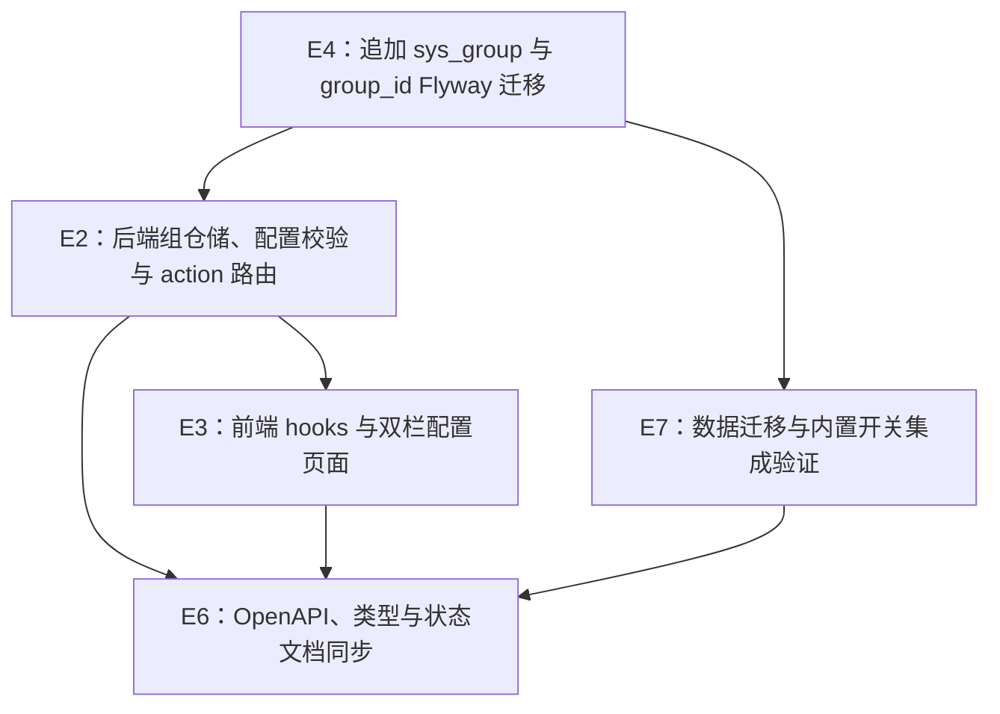

# Exec Plan

> **L4 · 交接点 1：意图 → 工程**。
>
> 本文件由 `tasks.md` 派生。实现细节只在执行笔记和代码中记录，不回写 `tasks.md`、`design.md` 或 `specs/**`。

## 1. 任务映射

| tasks.md 条目 | 执行单元 ID | 层 |
|---|---|---|
| `1.1` 架构与业务约束文档及共享模型设计 | `E1`（已完成） | L0 |
| `2.1` 配置分组持久化、配置业务校验与 action 路由 | `E2` | L1 |
| `3.1` 左侧分组导航与右侧动态配置面板 | `E3` | L2 |
| `4.1` `sys_dict` 合并迁移及 `dict_id` 改名 | `E4` | L0 |
| `5.1` 移除站点配置实现并保留媒体库 | `E5`（已完成） | L0 |
| `6.1` OpenAPI 声明、前端类型与状态文档同步 | `E2`、`E6` | L1 / L3 |
| `6.2` `user` 配置组和手机号登录开关种子验证 | `E7` | L3 |
| `2.2` 新增配置分组 action 与持久化 | `E2` | L1 |
| `3.2` 侧栏刷新/新增分组菜单及当前组默认值 | `E3` | L2 |
| `6.3` 新增分组 API 类型与状态文档同步 | `E2`、`E6` | L1 / L3 |
| `7.1` 分组新增与配置默认分组集成验证 | `E7` | L3 |
| `2.3` 分组元数据查询与名称编辑接口 | `E2` | L1 |
| `3.3` 侧栏元数据/编辑与右栏标题 | `E3` | L2 |
| `6.4` 分组元数据和编辑契约同步 | `E2`、`E6` | L1 / L3 |
| `7.2` 分组编辑与呈现集成验证 | `E7` | L3 |
| `3.4` 配置项标题、字段设置与新增按钮交互 | `E3` | L2 |
| `6.5` 配置项交互规格与状态文档同步 | `E6` | L3 |
| `7.3` 配置项交互回归验证 | `E7` | L3 |
| `2.4` 配置分组删除查询/API 与保护规则 | `E2` | L1 |
| `3.5` 配置分组可删除状态及删除操作 | `E3` | L2 |
| `6.6` 分组删除 API/状态文档同步 | `E6` | L3 |
| `7.4` 分组删除条件集成验证 | `E7` | L3 |
| `3.6` 设置图标与编辑弹窗删除按钮状态 | `E3` | L2 |
| `6.7` 同步字段设置操作呈现约定 | `E6` | L3 |
| `7.5` 验证设置图标和不可删除按钮状态 | `E7` | L3 |
| `3.7` 配置分组搜索、分页和响应式布局与字典列表对齐 | `E3` | L2 |
| `6.8` 同步配置分组列表交互约定与状态说明 | `E6` | L3 |
| `3.8` 移除删除状态标签与详情元数据并调整设置图标定位 | `E3` | L2 |
| `6.9` 同步分组详情与字段设置交互约定 | `E6` | L3 |

### 未映射条目

无。

### L7 测试基线

- 基线：`main`。本 change 基于当前 `main` 工作区，不叠加其他分支。
- 迭代验证：后端 `:weiran-system-domain:check`、`:weiran-system-application:check`、`:weiran-system-infrastructure:check`、`:weiran-system-adapter:check` 与 `:weiran-app:test`；前端 `pnpm --filter @weiran/web test`、`lint`、`build`。
- 最终门禁：按 `openspec/project.json` 的 `build`、`test`、`lint` 命令生成 L7 证据。

## 2. 依赖图

| 执行单元 | 前置 | 依赖性质 |
|---|---|---|
| `E2` | `E4` | E2 的仓储字段与类型过滤依赖新表及迁移列名 |
| `E3` | `E2` | 前端请求和分组呈现依赖 E2 冻结的路由及响应字段 |
| `E7` | `E4`、`E2` | 集成验证依赖迁移结果与配置读取行为 |
| `E6` | `E2`、`E3`、`E7` | 文档与手动类型同步最终实现 |

## 3. 分层执行计划

### Layer 0 —— 共享层，串行先做

| 执行单元 | 内容 | 涉及文件 |
|---|---|---|
| `E4` | 一次性追加 Flyway 脚本：重命名 `sys_dict` 为 `sys_group`；增加 `type`、`sort`；改为 `(type, code)` 唯一键；保留字典数据及 ID；重命名 `sys_dict_item.dict_id` 为 `group_id`；写入 `config/general`、`config/user` 分组 | `weiran4j/weiran-system/weiran-system-infrastructure/src/main/resources/db/migration/platform/V202610201001__platform_unify_dict_config_groups.sql` |

完成后只追加新迁移，不改历史迁移；验证文件时间戳全仓唯一，再冻结数据库结构契约。

### Layer 1 —— 后端

| 执行单元 | 内容 |
|---|---|
| `E2` | 配置分组来源改为 `sys_group(type=config)`；新增分组 create/update/delete action；查询可删除状态；内置组和非空组不可删除；字典持久化筛选 `type=dict`；配置保存校验组存在、启用且类型正确；Controller 路由调整为 `/api/system/config/{action}` 并同步 Springdoc 映射 |

### Layer 2 —— 前端

| 执行单元 | 内容 |
|---|---|
| `E3` | 配置查询 hooks 改用冻结的 action 路由；左栏复用字典列表的搜索/分页、操作菜单及响应式布局，显示创建时间和内置标识并支持新增/编辑/删除配置分组；新增配置项默认当前选中组；右栏标题只显示当前组名并展示动态表单 |

### Layer 3 —— 集成、文档与状态

| 执行单元 | 内容 |
|---|---|
| `E7` | 扩展 `PlatformIT` 验证旧字典记录及字典项关联值保留、配置组类型隔离、分组新增、`user` 组与关闭的手机号开关 |
| `E6` | 更新 `web/src/types/api.ts` 与 `openspec/state/bizs/{sys_config,sys_group}.md`；核对 `01-架构与接口契约.md` 只保留业务规则，不重复接口表。OpenAPI 路由声明由 E2 随 Controller 映射一起更新 |

`E1` 与 `E5` 已由当前基线验证，不在本轮重复执行。

## 4. 契约冻结

| 契约 | 签名 / 结构 | 定义位置 | 消费方（所读/所写） | 冻结 |
|---|---|---|---|---|
| 共享组表 | `sys_group` 保留字典原列及审计列，新增 `type`、`sort`；唯一键 `(type, code)`；字典项关联列 `group_id` | `E4` 新 Flyway 脚本 | `E2` 组仓储读写类型、名称、编码、状态、排序；字典项仓储读写 `group_id`；`E7` 验证迁移前后 ID 与关联值 | ☑ |
| 配置组查询 | `GET /api/system/config/listGroups` → `{key,label,isBuiltin,createdAt,canDelete}[]`，只含启用的 config 组 | `E2` ConfigController / `ConfigService` | `E3` 读取元数据渲染侧栏；`E7` 断言类型、内置标识、创建时间和删除状态 | ☑ |
| 配置组删除 | `DELETE /api/system/config/deleteGroup/{key}`；仅允许删除无配置项的非内置组；listGroups 增加 `canDelete` | `E2` ConfigController / `ConfigService` | `E3` 显示状态并调用；`E7` 验证保护与删除 | ☑ |
| 配置动作 | `listGroups`、`createGroup`、`updateGroup/{key}`、`deleteGroup/{key}`、`list`、`listAll`、`get/{id}`、`create`、`update/{id}`、`delete/{id}`、`getPublic/{key}`，详见 design.md DS-2 | `E2` Controller | `E3` hooks 调用；`E6` 从实现同步 OpenAPI 与 API 类型 | ☑ |
| 现有字典 HTTP 兼容 | 字典端点及 DTO 形状保持不变；底层记录固定筛选 `type=dict` | `DictController` / API DTO | 字典页面及 `DictSelect`、`DictTag` | ☑ |

### 契约变更记录

| 时间 | 原签名 | 新签名 | 发起方 | 已通知 |
|---|---|---|---|---|
| 2026-10-20 | `/api/configs/**`；固定领域分组 | `/api/system/config/{action}`；数据库分组 | 用户 | `E3`、`E6` |

## 5. 并行判据与文件所有权

本仓库没有 worktree，本 change 串行执行，不开并行 lane。

| 执行单元 | 拥有（可写） | 只读 | 禁止触碰 |
|---|---|---|---|
| `E4` | 新 platform Flyway 迁移脚本 | 既有 schema/seed 脚本、design.md | 历史迁移、业务模块迁移 |
| `E2` | `weiran-system-{api,domain,application,infrastructure,adapter}` 中配置与字典相关实现、Controller OpenAPI 注解及单元测试 | `web/**`、`weiran-framework/**` | `weiran-framework/**`、菜单种子 |
| `E3` | `web/src/hooks/queries/configs.ts`、`web/src/pages/system/configs/**`、配置组回车搜索/分页/每页条数及响应式列表布局 | 后端源码、`web/src/types/api.ts`（由 E6 更新） | `web/src/App.tsx`、后端源码 |
| `E7` | `weiran4j/weiran-app/src/test/java/com/weiran/app/PlatformIT.java` | 迁移及实现源码 | 应用生产代码、其他集成测试 |
| `E6` | `web/src/types/api.ts`、`openspec/state/bizs/{sys_config,sys_group}.md` | 已实现 Controller、前端页面 | 历史迁移、`tasks.md`、`design.md`、`specs/**`、Controller/DTO 源码 |

## 6. 测试归属

测试随实现单元，不设独立测试 lane。

| 执行单元 | 测试范围 | 测试文件 |
|---|---|---|
| `E2` | 领域与应用层组类型隔离、配置组校验 | `weiran4j/weiran-system/**/src/test/**` |
| `E3` | 左侧选组、右侧过滤、无分组/加载态、配置读写路径、配置项标题与设置/删除入口 | `web/src/pages/system/configs/**/__tests__/**` |
| `E7` | Flyway 升级与种子数据集成验证 | `weiran4j/weiran-app/src/test/java/com/weiran/app/PlatformIT.java` |

集成测试归属 `E7` 的迁移验收，不另设测试执行单元。

## 7. 失败与降级

| 场景 | 处置 |
|---|---|
| 迁移 SQL 或唯一索引与现有数据冲突 | 停止后端实现，检查现有数据与迁移假设；不得删除/改写已合入脚本 |
| 域模型/仓储签名必须调整 | 暂停前端消费方，先修实现与测试，再同步 OpenAPI/API 类型 |
| Gradle/JDK 或 Docker 环境失败 | 按 `rules/advisory/toolchain.md` 区分环境红灯并记录；不把环境失败记作实现通过 |
| 同一工作区出现其他 change 的并发编辑 | 按 WT-0 停止，待工作区状态可分辨后再继续 |

## 8. 收尾要求

串行执行时仍按单元写收尾笔记；必要连带文件在笔记中申报。最终 L7 证据只在全部实现完成后生成。

## Gate

- [x] 每条 task 已映射，或在未映射表说明原因
- [x] `explore.md` 的共享层清单已核对；唯一命中项 Flyway 迁移归 Layer 0 串行
- [x] 数据迁移遵守 CP-7：仅追加脚本、保留既有 ID/关联值；不涉及 `weiran-v1` 数据导入
- [x] 依赖图无环，API 路由契约在 design.md DS-2 已冻结
- [x] Layer 0 的数据库结构与配置路由契约已列出
- [x] 测试跟随实现，不存在独立测试执行单元
- [x] 串行执行，不存在同层文件所有权交叠
- [x] 每个执行单元的禁止触碰范围已写明
- [x] 失败与降级策略已填
- [x] 本文件派生自 tasks.md，未回写 tasks.md / design.md / specs/**
