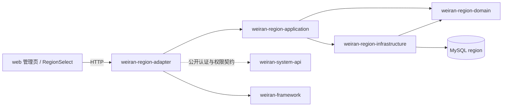

# Design

> 保持意图粒度：描述行为如何，逐文件实现步骤留给执行计划。

## Context

- 需求来源：`interview.md`
- 现有实现调研：`explore.md`
- 能力规格：`specs/administrative-regions/spec.md`
- 参考实现：mono4ts 的 `regions.service.ts`、`routes/platform/regions.ts`、`RegionSelect.tsx` 与 `china-division@2.7.0` 初始化快照。
- 关键约束：Java 21、DDD 五层、MySQL 8、Flyway 只追加迁移、前后端契约以 `weiran4j/docs/01-架构与接口契约.md` 为准；管理树按同级 ID 倒序且页面表格有弹性列。

## 宪法对照

| 原则 | 判定 | 说明 |
|---|---|---|
| CP-1 领域层不依赖框架 | ☑ 符合 | 地区层级与父子关系校验放在纯 Java domain，不引用 Spring 或 MyBatis 类型。 |
| CP-2 依赖方向单向向内 | ☑ 符合 | 依赖仅为 adapter/application/domain 与 infrastructure/domain，适配层通过端口访问持久化。 |
| CP-3 持久化类型不跨层 | ☑ 符合 | DO、Mapper 与 MyBatis-Plus 类型仅在 infrastructure；端口和 DTO 使用领域/纯 Java 类型。 |
| CP-4 版本号只有一个来源 | ☑ 符合 | 不添加框架版本；模块使用仓库 BOM 管理的现有依赖版本。 |
| CP-5 质量规则只在 build-logic 里配置 | ☑ 符合 | 不改质量插件配置或模块级质量规则。 |
| CP-6 豁免必须最小且带理由 | ☑ 符合 | 不新增质量规则豁免。 |
| CP-7 表结构只经 Flyway 迁移变更，已发布的迁移永不修改 | ☑ 符合 | 通过地区 infrastructure 新增迁移创建业务表并装载固定快照；菜单和按钮种子使用添加式迁移，不修改既有迁移。 |
| CP-8 密码只用 BCrypt，令牌吊销只走 token_version | ☐ 不涉及 | 不处理密码或令牌签发、吊销。 |
| CP-9 凭据不进版本库、不进日志 | ☑ 符合 | 本模块不新增凭据；操作日志只记录地区操作，不记录认证凭据。 |
| CP-10 认证失败不泄露账号存在性 | ☐ 不涉及 | 不新增认证或账号查询逻辑。 |
| CP-11 错误码归属决定 HTTP 状态，不靠 Controller 判断 | ☑ 符合 | 领域错误映射至已登记的 `weiran-region-api` 业务错误码，Controller 不自行判定 HTTP 状态。 |
| CP-12 依赖只能业务 → 基座 → 框架，反向与同层横向禁止 | ☑ 符合 | `weiran-region` 仅作为业务模块依赖基座 API 与框架契约，不形成跨业务依赖。 |
| CP-13 业务只经基座的 weiran-system-api 接触基座 | ☑ 符合 | 运行时仅依赖 `weiran-system-api` 的公开契约；菜单授权数据由本模块 Flyway 添加式种子迁移写入既有授权表，不增加运行时对 `sys_*` 的读写。 |
| CP-14 错误码按号段分配，业务不得占用框架与基座的号段 | ☑ 符合 | 在 `docs/business-modules.md` 登记 `weiran-region` 错误码序号段 `20`–`29`，仅定义地区特有错误。 |
| CP-15 权限码、菜单 id 与 Flyway 模块段按层隔离 | ☑ 符合 | 使用 `region:` 权限；菜单使用业务 ID 段 `1000`–`1099`；迁移放在 `region/` 目录并登记全局版本号。 |

## Architecture

模块由根目录五层发现规则自动加入 Gradle、BOM 和应用聚合，不修改静态模块清单。adapter 与 infrastructure 通过模块自身 `@AutoConfiguration` 和 imports 装配。业务模块运行时不查询 `sys_*` 表。

## Data Flow

1. 初始化迁移创建地区业务表并插入固定版本行政区划快照；每条地区以字符串 `code` 唯一标识，`parent_code` 关联父级 code，省级无父级。
2. 管理 API 经认证拦截器与 `region:*` 权限校验后调用 application 用例；输入先由领域规则验证，再由 repository port 持久化。
3. 树查询先应用状态/级别/关键词筛选，关键词命中后代时补齐祖先；接口按业务 `sort`、`code` 排列，页面为遵守列表规范将每级同级项转为 ID 倒序。
4. 创建/移动在事务中校验 code 唯一、父级存在且层级恰为上一级，并拒绝自身或后代作为新父级；删除仅允许叶节点。写动作使用 `@OperationLog`。
5. 登录态 lookup 不检查地区管理权限，只返回启用节点且仅保留启用祖先链；级联选择器将树转为 Semi Cascader 选项，值为 code 路径。
6. CSV 导出复用管理筛选条件查询全部匹配记录，输出 UTF-8（含 BOM 以兼容常见表格软件），字段顺序为 ID、名称、区划代码、级别、父级代码、排序、状态、创建时间；导出范围不受页面展开状态或可视行数影响。

## Shared 契约变更

| 对象 | 文件 | 动作 | 消费方 |
|---|---|---|---|
| 地区 API 与数据模型 | `weiran4j/docs/01-架构与接口契约.md` | 登记路由、字段、权限、错误码、表结构和菜单 | 后端 adapter、`web/src/types/api.ts`、地区页面与组件 |
| 业务模块资源段 | `weiran4j/docs/business-modules.md` | 登记权限前缀、菜单 ID、错误码序号段、表与迁移目录 | 本模块及后续业务模块 |
| 前端地区类型 | `web/src/types/api.ts` | 手动同步请求、树/平铺/详情/级联响应 DTO | queries、页面与 RegionSelect |
| 组件注册 | `openspec/rules/advisory/components.md` | 登记新建的可复用 `RegionSelect` | 后续前端页面 |

不改 `weiran-framework` 通用分页/错误包络，不新增通用导出中心，不改构建自动发现文件。

## API Design

所有响应沿用 `{code, message, data}` 数字 code 包络。管理接口通过现有认证拦截器和权限注解保护；写接口均使用 `@OperationLog`。地区 ID 使用数据库生成的 long ID，区划 code 按字符串保留前导零。

| 路由 | 方法 | 请求关键字段 | 返回关键字段 | 权限点 |
|---|---|---|---|---|
| `/api/regions/tree` | GET | `keyword?`, `level?`, `status?` | `RegionNode[]`，含 `children` | `region:list` |
| `/api/regions/flat` | GET | `keyword?`, `level?`, `status?` | `RegionView[]` | `region:list` |
| `/api/regions/{id}` | GET | path `id` | `RegionView` | `region:list` |
| `/api/regions` | POST | `code`, `name`, `level`, `parentCode?`, `sort`, `status` | 新建 `RegionView` | `region:create` |
| `/api/regions/{id}` | PUT | `name`, `level`, `parentCode?`, `sort`, `status`；若传 `code` 必须与原值一致 | 更新后 `RegionView`；区划代码创建后不可修改 | `region:update` |
| `/api/regions/{id}` | DELETE | path `id` | 无业务数据 | `region:delete` |
| `/api/regions/lookup` | GET | 无 | 仅启用节点树 | 仅需登录 |
| `/api/regions/export` | GET | 与 tree 相同筛选项 | CSV 文件流 | `region:export` |

筛选不使用分页，因为全量地区共 3351 条且树管理/导出均需完整匹配集；不扩展通用 `PageQuery`。错误码在本模块已登记的 `20`–`29` 序号段内定义：重复 code、非法父级/循环和非叶删除分别给出稳定业务错误；code 修改使用通用冲突 `40901`；不存在的 ID 使用统一资源不存在错误，权限/认证错误复用基座规则。

## Database Design

| 表 | 动作 | 关键字段 | 索引 | 备注 |
|---|---|---|---|---|
| `region` | 新增 | `id` bigint 主键、`code` varchar 唯一、`name`、`level`、`parent_code` nullable、`sort`、`status`、创建/更新审计字段 | unique(`code`)、index(`parent_code`)、index(`level`,`status`) | 不引用 system 内部表；code 作为层级关联键，保留行政区划前导零。 |

初始迁移固定导入 `china-division@2.7.0` 的 3351 条快照（31/342/2978），随迁移注明来源及 WTFPL 许可；初始化 SQL 可重复核验但 Flyway 仅执行一次。后续快照修订另加迁移，不回写本迁移。省、市、县分别限定父级为空、省级、市级；数据层不强制省/市/县之外的级别。

## 权限 / 数据范围 / 租户

| 项 | 设计 |
|---|---|
| 权限点 | 管理树/平铺/详情 `region:list`；新增 `region:create`；修改/启停 `region:update`；删除 `region:delete`；导出 `region:export`。 |
| 菜单挂载 | 添加式 Flyway 迁移登记目录菜单 `system/regions/RegionsPage` 与按钮权限，使用 `sys_menu` 业务 ID 1000–1099；这是种子授权数据，不形成业务模块运行时访问基座表的依赖。 |
| 登录态 lookup | `GET /api/regions/lookup` 只要求登录，供一般业务页面使用，不要求 `region:list`。 |
| 数据范围 / 租户 | 本能力提供全国公共行政区划，不按用户部门、租户或数据范围过滤。 |
| 审计 | 所有新增、修改、删除及状态变更使用 `@OperationLog`；查询与导出不写操作审计。 |

## 分层与装配

| 项 | 设计 |
|---|---|
| 依赖方向 | `adapter → application → domain`、`infrastructure → domain`；application 依赖端口抽象，不依赖 infrastructure。 |
| 依赖范围 | 只依赖 `weiran-system-api` 和 `weiran-framework` 的允许契约，以及本模块内部层；不依赖其它业务模块。 |
| 自动配置 | adapter 和 infrastructure 各自声明 `@AutoConfiguration` 并写入 Spring imports，遵循现有模块装配方式。 |
| 聚合构建 | 五层目录齐全后由 Gradle 自动发现；不改 `settings.gradle.kts`、BOM 或 `weiran-app` 聚合配置。 |

## 前端设计

| 项 | 内容 |
|---|---|
| 页面/路由 | `web/src/pages/system/regions/RegionsPage.tsx`，由菜单 component 驱动注册，不改 `App.tsx`。 |
| 可复用组件 | 新增 `web/src/components/RegionSelect.tsx` 作为省市县级联选择器，并登记到 `components.md`；页面复用 PageContainer、SearchToolbar、ColumnSettings、TableActions、StatusTag、请求与 query 工具。 |
| 数据请求 | `web/src/hooks/queries/regions.ts` 封装树、平铺、详情、写操作、lookup 与导出；写成功后失效地区树/详情 query。 |
| 管理表格 | 树形表格默认折叠；ID 为首列且同级 ID 倒序；至少一个名称/操作列使用弹性宽度，容器填满可用宽度；关键词筛选命中后端补齐祖先。 |
| 导出 | 当前筛选条件生成下载 URL/Blob，不依赖树展开状态；仅 `region:export` 可见并可调用。 |
| 权限控制 | 页面操作按钮分别使用 `region:create/update/delete/export`；管理查询由 `region:list` 菜单/权限控制；lookup 组件只依赖登录会话。 |
| 状态与级联 | 可单独启停任一地区；选择器隐藏停用节点及停用祖先链以下节点，选中值为 code path。 |

## Observability

- 日志关键字段：操作日志记录动作、地区 ID/code 与结果，不记录完整请求凭据。
- 指标：沿用现有 HTTP 请求指标，不新增专属指标。
- 审计：创建、更新、删除及状态变更必须有 `@OperationLog`；本模块不涉及登录日志。
- 告警 / 排障入口：Flyway 初始化失败、唯一键冲突和地区校验错误通过现有应用日志与统一异常响应排查。

## Test Plan

| 层级 | 范围 | 验证 |
|---|---|---|
| domain 单测 | 省市县父级规则、自父级/后代循环、叶节点删除、区划 code 与级别验证 | `./gradlew :weiran-region-domain:test` |
| application/infrastructure | 筛选保留祖先、同级排序、3351 条数据完整性、状态 lookup、事务写与非法请求数据不变 | `./gradlew :weiran-region-application:test :weiran-region-infrastructure:test` |
| adapter 集成 | 管理权限 403、登录 lookup、CRUD 错误码、操作审计、CSV 编码与全量筛选 | `./gradlew :weiran-app:test --tests '*Region*IT'` |
| 前端 | 管理页权限按钮、ID 倒序/弹性列、导出筛选；RegionSelect code 路径与禁用节点 | `pnpm --filter @weiran/web test`；布局在真浏览器检查 |
| 全量门禁 | 编译、测试、Checkstyle、SpotBugs、Forbidden APIs、Error Prone/NullAway、覆盖率与 OpenSpec | JDK 21 下 `./gradlew spotlessApply`、`./gradlew check --no-daemon`、`pnpm test`、`pnpm lint`、`pnpm build`、`node openspec/check.mjs` |

## Rollout Plan

1. 先部署包含完整地区模块的应用，再由 Flyway 创建 `region` 并写入固定行政区划快照和菜单权限种子。
2. 为管理员角色授予地区菜单与相应按钮权限；普通登录用户无需管理权限即可使用 lookup。
3. 发布前核验迁移记录、3351 条数量、区划父子关系、菜单 component 与前端页面路径；通过地区管理页抽查检索、修改、停用和 CSV 下载。

## Rollback Plan

1. 回滚锚点：引入 `weiran-region` 的合并提交（merge commit）；回滚前停止该版本应用实例，避免新旧实例并行写地区表。
2. 应用回滚后保留 `region` 与 Flyway 迁移历史，避免破坏已执行迁移或被其它页面引用的数据；菜单权限种子可在后续专用迁移中停用，不直接删除已发布迁移。
3. 如果需要彻底撤销地区数据，另行评估并新增向前兼容的清理迁移；本 change 不提供自动 drop/反向迁移。

## Open Questions

- 无；接口、权限、数据范围、初始快照和回滚行为均已在本设计确定。
