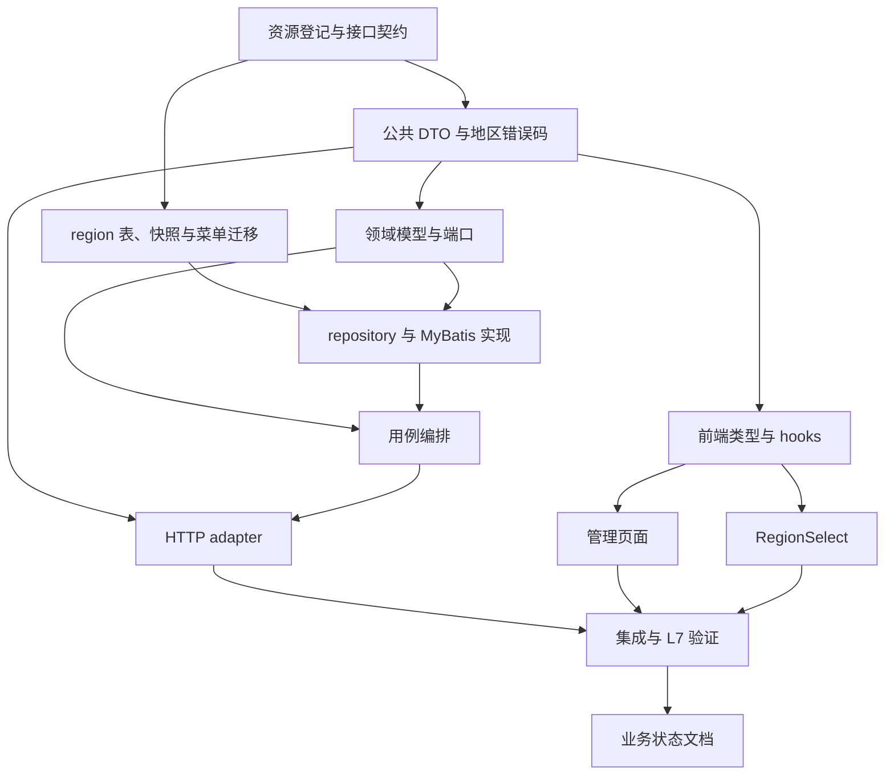

# Exec Plan

> L4 · 交接点 1：意图 → 工程。本计划由 `tasks.md` 派生，实施细节不回写上游规格。

## 1. 任务映射

| tasks.md 条目 | 执行单元 ID | 层 |
|---|---|---|
| `0.1` | `E0` | L0 |
| `1.1` | `E0` | L0 |
| `1.2` | `E1` | L0 |
| `2.1` | `E2` | L0 |
| `3.1` | `E3` | L1 |
| `3.2` | `E3` | L1 |
| `4.1` | `E4` | L1 |
| `4.2` | `E5` | L1 |
| `5.1` | `E6` | L1 |
| `6.1` | `E7` | L1 |
| `6.2` | `E8` | L1 |
| `6.3` | `E9` | L1 |
| `7.1` | `E3`, `E4` | L1 |
| `7.2` | `E5`, `E6`, `E8`, `E9` | L1 |
| `7.3` | `E10` | L2 |
| `8.1` | `E10` | L2 |
| `9.1` | `E11` | L2 |

### 未映射条目

无。

### L7 测试基线

- 基线：`main`；当前主工作区已有用户修改 `web/.env.development` 与 `WeiranApplication.java`，执行与提交时均保留且不纳入本 change。
- 最终 L7 唯一事实源为 `openspec/project.json` 的 build/test/lint 命令；全部实现合并后依次生成证据。

## 2. 依赖图

| 执行单元 | 前置 | 依赖性质 |
|---|---|---|
| `E1` | `E0` | 类型依赖：DTO/error 定义必须遵循冻结 API 契约。 |
| `E2` | `E0` | 数据依赖：菜单 ID、错误/权限登记与 Flyway 路径先冻结。 |
| `E3` | `E1` | 类型依赖：领域/API 公共模型与错误签名已冻结。 |
| `E4` | `E2`, `E3` | 数据/类型依赖：repository 实现依赖表结构、领域模型和端口。 |
| `E5` | `E3`, `E4` | 调用依赖：用例编排领域规则和存储端口实现。 |
| `E6` | `E1`, `E5` | 契约/调用依赖：Controller 暴露已冻结签名并调用应用用例。 |
| `E7` | `E1` | 契约依赖：TS 类型和请求 hooks 按冻结接口实现。 |
| `E8` | `E7`, `E6` | 契约依赖：页面调用 hooks 展示已实现管理 API。 |
| `E9` | `E7`, `E6` | 契约依赖：组件调用 login lookup API。 |
| `E10` | `E6`, `E8`, `E9` | 验证依赖：集成验证覆盖完整 API 与 UI 行为。 |
| `E11` | `E10` | 文档依赖：现状文档按已验证实现记录。 |

## 3. 分层执行计划

### Layer 0 —— 契约与迁移，串行完成

| 执行单元 | 内容 | 涉及文件 |
|---|---|---|
| `E0` | 确认资源号段；同步前后端接口契约、权限、错误码、表与菜单路径 | `weiran4j/docs/01-架构与接口契约.md`、`weiran4j/docs/business-modules.md` |
| `E1` | 定义 API DTO 与地区错误码，冻结签名 | `weiran-region/weiran-region-api/**` |
| `E2` | 添加 `region` 表、3351 条固定数据与 menu/button 授权种子迁移 | `weiran-region/weiran-region-infrastructure/src/main/resources/db/migration/region/**` |

完成判据：契约表全部冻结；迁移版本与菜单 ID 唯一；数据、路由、字段、错误码和 TS 使用的契约一致。该模块不修改 `weiran-framework`、Gradle 注册/BOM/app 聚合。

### Layer 1 —— 模块实现与前端

| 执行单元 | 内容 |
|---|---|
| `E3` | 领域实体/规则/端口/单测。 |
| `E4` | MyBatis repository、映射、查询筛选/祖先补齐/排序、事务持久化与基础设施测试。 |
| `E5` | 用例编排、业务异常映射、全量导出查询行为与应用测试。 |
| `E6` | 管理与 lookup/CSV Controller、认证权限、审计、自配置/装配及 adapter 集成测试。 |
| `E7` | 前端 API 类型、query hooks、mutation 与下载封装。 |
| `E8` | 地区管理页面、菜单页面路径配对、搜索筛选/表格/增改删/启停/权限/导出。 |
| `E9` | RegionSelect 级联控件与组件登记。 |

执行单元虽列为同层，但存在图中明确依赖，按 DAG 交替实施；同一工作区不同时写入，所有权不得交叉。

### Layer 2 —— 集成验收与现状收尾

| 执行单元 | 内容 |
|---|---|
| `E10` | 运行后端与前端目标测试、真实浏览器检查；随后按 `project.json` 命令表运行完整 L7 并保存证据。 |
| `E11` | 根据通过验收的代码补 `openspec/state/bizs/region.md` 并更新 state 文件索引。 |

## 4. 契约冻结

| 契约 | 签名 / 结构 | 定义位置 | 消费方(逐单元列出所读/所写的键) | 冻结 |
|---|---|---|---|---|
| 管理树 | `GET /api/regions/tree?keyword&level&status` → `RegionNode[]`（id/code/name/level/parentCode/sort/status/children） | `docs/01-架构与接口契约.md`、`weiran-region-api` | `E5` 产出树结构；`E6` 读取过滤参数并输出 DTO；`E7` 定义 query 类型；`E8` 读取 children 与节点字段 | ☑ |
| 平铺/详情 | `GET /api/regions/flat?...`；`GET /api/regions/{id}` → `RegionView` | 同上 | `E6` 输出完整视图；`E7` 定义类型和 query；`E8` 详情/表单使用 id、code、name、level、parentCode、sort、status | ☑ |
| 写接口 | `POST /api/regions`；`PUT /api/regions/{id}`；`DELETE /api/regions/{id}` | 同上 | `E1` 定义输入/响应；`E5` 执行校验和持久化；`E6` 校验权限并调用用例；`E7` 定义 mutation；`E8` 读写完整表单字段 | ☑ |
| lookup | `GET /api/regions/lookup` → 仅启用地区树 | 同上 | `E5` 过滤启用祖先链；`E6` 仅要求登录；`E7` 定义树类型；`E9` 读取节点 code/name/children 并写入 code path | ☑ |
| CSV | `GET /api/regions/export?...` → UTF-8 CSV | 同上 | `E5` 查询全量匹配结果；`E6` 输出字段顺序/文件头；`E7` 下载响应；`E8` 提交当前筛选条件 | ☑ |
| 存储 | 表 `region`：id、code、name、level、parent_code、sort、status、审计字段 | `design.md` 与 Flyway migration | `E2` 建表填充；`E3` 通过领域 code/层级；`E4` 映射全部字段、按 parent_code 构树和过滤 | ☑ |
| 权限 | `region:list/create/update/delete/export` | 契约文档与 menu seed migration | `E2` 写菜单/按钮种子；`E6` 标注服务端权限；`E8` 控制操作入口 | ☑ |

### 契约变更记录

| 时间 | 原签名 | 新签名 | 发起方 | 已通知 |
|---|---|---|---|---|
| 2026-10-19 | 无 | 本节所列地区 API、DTO、表与权限契约 | L3 已批准设计 | 所有执行单元 |

## 5. 并行判据与文件所有权

| ID | 场景 | 能否与他人并行 | 原因 |
|---|---|---|---|
| WT-0 | 工作区已有未提交用户变更 | 本 change 与其隔离文件推进；不改、不暂存、不提交该等文件 | 现存用户改动在 `web/.env.development` 和 `weiran-app/WeiranApplication.java`，与已批准的 `weiran-region` 文件集不相交；最终 diff 逐路径审阅。 |
| WT-1 | 当前 change 内 | 不同时写工作区；按 DAG 交替推进 | 本仓库只有一个工作区，文件所有权用来防止执行单元交叉，不代表并发写。 |
| WT-2 | 涉及 `weiran-framework`/流水线本体 | 不适用 | 本 change 不改共享框架或流水线本体。 |
| WT-3 | 新增独立业务模块及前端功能 | 按执行单元交替 | 包间契约与迁移先冻结；同层拥有文件不相交。 |

| 执行单元 | 拥有(可写) | 只读 | 禁止触碰 |
|---|---|---|---|
| `E0` | `weiran4j/docs/**`、`openspec/changes/weiran-region/**` 的契约段 | 现有 API/菜单规范 | 用户已有改动文件 |
| `E1` | `weiran-region/weiran-region-api/**` | `design.md`、契约 | 其它模块与前端 |
| `E2` | 地区 infrastructure migration | `docs/business-modules.md`、系统菜单迁移 | 已合入 migration、`sys_*` 运行时代码 |
| `E3` | 地区 domain | 地区 API DTO | 其它模块 |
| `E4` | 地区 infrastructure Java | 领域规则/端口 | 已合入 migration、其它模块 |
| `E5` | 地区 application | DTO、repository 实现 | adapter、web、其它模块 |
| `E6` | 地区 adapter | API、application ports | web 与基座实现 |
| `E7` | `web/src/types/api.ts`、地区 query hook 文件 | 契约与 adapter API | 用户已有 `web/.env.development` |
| `E8` | `web/src/pages/system/regions/**` | hooks、组件协议 | `web/.env.development` 与其它页面 |
| `E9` | `web/src/components/RegionSelect.tsx`、`components.md` | lookup API、Semi 组件约定 | 其它组件与用户 `.env` |
| `E10` | 地区测试文件与 `exec/evidence/**` | 所有实现 | 任一用户已有修改文件 |
| `E11` | `openspec/state/bizs/region.md`、`openspec/state/bizs/README.md` | 已验收代码 | 用户已有修改文件 |

## 6. 测试归属

| 执行单元 | 测试范围 | 测试文件 |
|---|---|---|
| `E3` | 地区级别、父级与环规则、叶节点删除 | 地区 domain 测试 |
| `E4` | SQL 筛选/排序/祖先补齐、快照完整性与 repository 映射 | 地区 infrastructure 测试 |
| `E5` | 用例输入校验、CRUD/lookup/export 范围 | 地区 application 测试 |
| `E6` | 权限、认证、操作日志、统一错误响应与 CSV HTTP 行为 | 地区 adapter / app 集成测试 |
| `E8` | 管理页面筛选、权限操作、ID 倒序与弹性列 | 页面测试 |
| `E9` | lookup 加载、禁用祖先过滤、受控 code path | RegionSelect 测试 |
| `E10` | L7 全仓构建/测试/lint 及真实浏览器验收记录 | `exec/evidence/*.log` 与手工验收记录 |

## 7. 失败与降级

| 场景 | 处置 |
|---|---|
| 执行单元产出不可用或编译失败 | 停止依赖单元，先修复当前单元并重跑对应最小验证。 |
| 迁移号/菜单号发现冲突 | 暂停 migration，重新检查 `business-modules.md` 与全仓 migration 历史，更新契约后再继续。 |
| API/字段契约需要变更 | 暂停所有消费单元，更新契约和受影响的规格，必要时重走 L3 审批。 |
| 同一工作区用户修改与目标文件发生冲突 | 不覆盖用户改动；停止并报告冲突文件与差异，等待处理。 |
| L7 某命令失败 | 记录完整命令与日志，定位并修复本 change 引起的问题后重跑受影响门禁；若证实为外部基线故障，按 verify 规则记录并暂缓。 |

## 8. 收尾要求

每个执行单元完成后记录实际验证、必要连带修改与未完成项；所有测试随实现完成，不另设测试执行单元。真实执行结果写入 `exec/evidence/`，不回写 `tasks.md` 或 `design.md`。

## Gate

- [x] 每条 task 都已映射
- [x] explore 共享层清单已逐项比对；数据库迁移归 Layer 0
- [x] 数据库结构只通过新增 Flyway migration；不存在 weiran-v1 兼容性要求，本模块是 D-008 后新业务表
- [x] 依赖图无环，前后端依赖冻结 API 契约
- [x] Layer 0 契约冻结表已列出并填充
- [x] 无独立测试执行单元，测试随实现单元
- [x] 所有权按文件集拆分且互不重叠
- [x] 每个执行单元有禁止触碰范围
- [x] 失败与降级策略已填
- [x] 本计划未回写 tasks、design 或 specs
