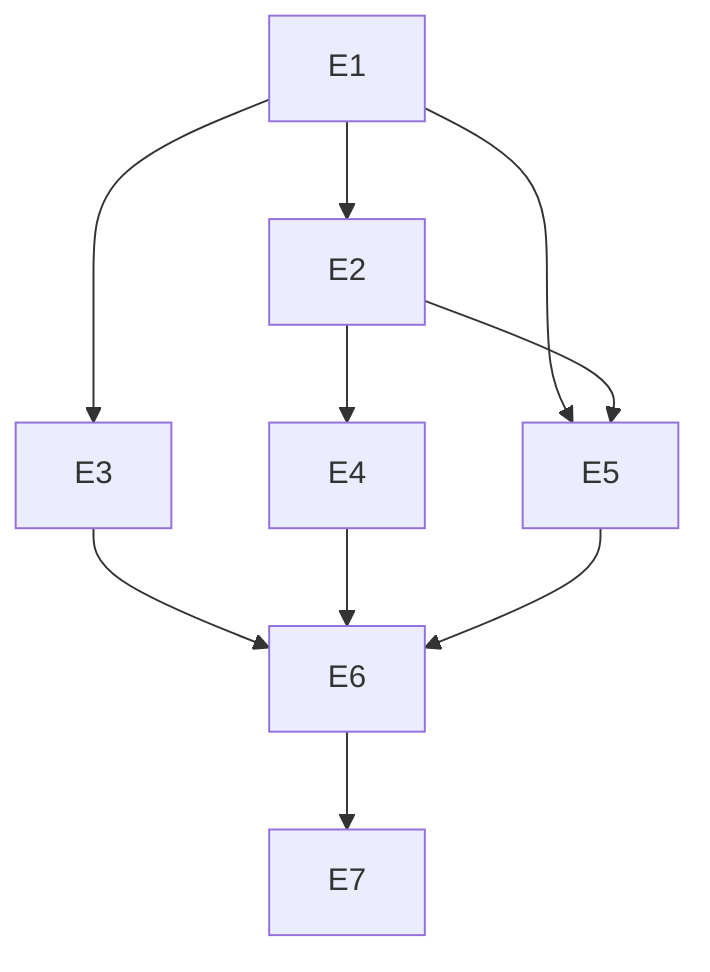

# Exec Plan

## 1. 任务映射

| tasks.md 条目 | 执行单元 ID | 层 |
|---|---|---|
| `1.1` | `E1` 框架通用码 | Layer 0 |
| `2.1` | `E2` 系统认证码 | Layer 1 |
| `2.2` | `E3` 地区码 | Layer 1 |
| `3.1` | `E4` 系统调用处 | Layer 2 |
| `5.1` | `E5` 前端消费者 | Layer 2 |
| `6.1` | `E6` 随实现单元验证及最终集成 | Layer 3 |
| `7.1` | `E7` 现状与契约文档 | Layer 3 |

### 未映射条目

无。

### L7 测试基线

基线为当前 `main`；使用 `openspec/project.json` 中的后端、前端、规格门禁命令。

## 2. 依赖图

依赖性质：E2/E3/E5 消费 E1 冻结的码结构；E4/E5 消费 E2 的系统码；E6 检查所有实现；E7 根据最终实现更新说明。

## 3. 分层执行计划

| 层 | 单元 | 内容 |
|---|---|---|
| Layer 0 串行 | E1 | 框架通用码与错误码契约，冻结服务号与数字响应类型 |
| Layer 1 | E2、E3 | system 和 region 在各自 api 定义专属码 |
| Layer 2 | E4、E5 | 后端调用处及 web 按码行为 |
| Layer 3 | E6、E7 | 跟随实现的检查、现状与契约文档 |

本仓库没有 worktree；实际执行在同一工作区串行完成。

## 4. 契约冻结

| 契约 | 签名 / 结构 | 定义位置 | 消费方 | 冻结 |
|---|---|---|---|---|
| `ErrorCode` | `int code()`、`int httpStatus()`、`String message()` | `weiran-framework/error/ErrorCode.java` | E2/E3 写码值；E4 读码值；E5 读 JSON 数字码 | ☑ |
| 通用服务号 | `10`，资源 `00` 通用、`01` 安全 | `CommonErrors.java` | E4 抛出通用码；E5 识别 `100101` | ☑ |
| 系统服务号 | `11`，资源 `01` 认证 | `SystemAuthErrors.java` | E4 抛出系统码；E5 识别 `110101` 等 | ☑ |
| 地区服务号 | `12`，资源 `01` 区划 | `RegionErrors.java` | E6 校验 `120101` 至 `120103` | ☑ |

### 契约变更记录

用户最终指定通用 `10`、系统 `11`、地区 `12`，已覆盖先前暂定编号；所有消费方已同步。

## 5. 并行判据与文件所有权

| ID | 判定 | 原因 |
|---|---|---|
| WT-0 | 不与他人并行 | 工作区存在多项待提交改动，统一由当前执行链维护 |
| WT-1 | 可交替 | 规格与文档验证不占用 Gradle 构建 |
| WT-2 | 不并行 | 命中 `weiran-framework` 跨模块契约 |
| WT-3 | 不采用 | 本次改动横跨多个模块 |

| 单元 | 拥有(可写) | 只读 | 禁止触碰 |
|---|---|---|---|
| E1 | `weiran-framework/error/**` | 其他模块消费者 | 历史迁移与归档 change |
| E2 | `weiran-system-*/**` 中认证错误定义 | E1 | `weiran-framework/**` |
| E3 | `weiran-region-api/**` 中错误定义 | E1 | `weiran-system-*/**` |
| E4 | system 认证调用处 | E1/E2 | region、web |
| E5 | `web/src/**` 按码消费者 | E1/E2/E3 | 后端模块 |
| E6 | 对应实现的测试与检查证据 | 全部实现 | 不改业务语义 |
| E7 | 当前契约、现状文档与本 change delta spec | 全部实现 | 历史归档与决策记录 |

## 6. 测试归属

测试随 E1 至 E5 的实现维护；E6 汇总全量门禁结果，不独立修改实现。

## 7. 失败与降级

| 场景 | 处置 |
|---|---|
| 检查失败 | 定位对应单元修复并重跑一次 |
| 再次失败 | 暂停集成，保留失败证据并上报 |
| 契约需要变更 | 暂停消费方，修订冻结表并重审设计 |
| 文件集冲突 | 停止并行，串行整合 |

## 8. 收尾要求

单工作区由当前执行链完成；实现结论与测试证据写入 `exec/verify.md`。

## Gate

- [x] 每条 task 已映射
- [x] 共享层命中项归入 Layer 0
- [x] 不涉及表结构变更，遵守 CP-7
- [x] 依赖图无环且识别前后端契约依赖
- [x] Layer 0 契约冻结表已填
- [x] 测试跟随实现
- [x] 文件所有权不相交
- [x] 禁止触碰范围已写明
- [x] 失败与降级策略已填
- [x] 未因本执行计划回写上游 artifacts
